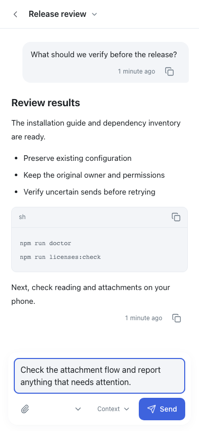

# Pocket

[简体中文](README.md) · English

> **Your Codex. In your pocket.**
>
> Work keeps running on your Mac. Keep the conversation moving from your phone.

Pocket brings **existing Codex conversations on your Mac** to a browser and phone PWA: follow progress, read results, add instructions, send attachments, and handle supported questions and approvals. The original desktop owner keeps execution, model, working directory and permissions.

[See it running](#runtime-screenshots) · [Why Pocket exists](#why-pocket-exists) · [Compare alternatives](#choosing-between-solutions) · [Get started](#start-on-your-mac)


## Why Pocket exists

Codex has become a place for more than a short coding prompt: ongoing development, research, documents and files can span long conversations. Away from the desk, we still want to see what happened, add a direction or answer a question, then return to the same work.

Pocket grew from that everyday need. Its starting point is **the Mac Codex desktop workflow you already use**. It organizes conversation discovery, long-form reading, Markdown/code/diagrams, file previews, input and supported actions for a phone. You own the web/API/HTTPS entry, can inspect the source and can adapt the interface to your habits.

Its reasons to choose come as a focused combination:

- **Keep your existing workbench:** read original conversations, resolve the original desktop owner by thread ID and retain model, directory and permissions. Mobile continuation starts from your current desktop routine.
- **Use a browser as the entry:** open your self-hosted app from a phone, tablet or another computer; install the phone PWA to the home screen. You manage its entry and maintenance.
- **Read and continue ongoing work:** project/follow/status views help find a task; structured text and file previews help understand results; draft, selection and reading-position protections reduce interruptions.
- **Keep receipts distinct from execution:** acceptance is separate from model completion; uncertain outcomes are checked by the original request instead of replayed, and late responses must not replace newer input.

These are design priorities and implementation choices, not claims of exclusive capabilities. Official Remote and other open-source tools also continue existing work. If one already meets your needs, using it avoids an extra self-hosted service.

## Runtime screenshots

These are **screenshots of the actual compiled application**, using synthetic conversations and example questions. They are not design mockups or private chats. English and Simplified Chinese use the same features.

**Desktop: find conversations by project, see activity and continue the same work from your phone.**


| Read and write on your phone | Answer questions on your phone |
| --- | --- |
|  |  |

## Choosing between solutions

Checked against **official documentation and source on 2026-11-13**. This is a workflow comparison, not a hands-on ranking; features continue to evolve.

| Solution | Workflow it emphasizes | Where Pocket fits |
| --- | --- | --- |
| [Official ChatGPT / Codex apps and Remote](https://learn.chatgpt.com/docs/remote-connections) | Official Chat, Work and Codex; Remote already continues existing conversations on connected hosts, handles approvals and reviews outputs/diffs. Availability depends on rollout/workspace settings | Consider Pocket for a self-hosted browser/PWA service, your own entry and editable interface centered on Mac Codex conversations. The official route is less maintenance when it fits |
| [HAPI](https://github.com/tiann/hapi) | Official-agent wrappers with a Hub/Runner, terminal-to-phone/Web/native continuation; Codex desktop-history discovery, import, sync and resume already exist | Pocket starts directly from the existing Mac Codex Desktop catalog and desktop execution owner; it does not claim HAPI lacks existing conversations |
| [Happy](https://github.com/slopus/happy) | Original CLI plus Desktop/Agent, native mobile/Web, multiple models, shared agents and content E2EE | Pocket focuses on one owner's Mac Codex browser experience. Native apps, multi-model/multi-user workflows and E2EE are different requirements, outside its current promises |
| [T3 Code](https://github.com/pingdotgg/t3code) | Unified coding-agent workbench with server/provider execution, Git/worktrees and desktop/Web/native mobile; importing and continuing existing conversations is supported | Pocket adds reading/continuation to an existing Codex Desktop routine; compare T3 Code when you want a unified coding workbench |
| [Codex Mobile Bridge](https://github.com/try2love/codex-mobile-bridge) | Original-client continuation, now spanning multiple clients, a desktop gateway, native mobile and Web; directly overlaps Pocket | The closest open-source alternative to compare. Pocket deliberately chooses the narrower Mac Codex + browser/PWA scope; its value needs actual reading, input and recovery feedback |
| [CodexMonitor](https://github.com/Dimillian/CodexMonitor) | Tauri multi-workspace/agent workbench, per-workspace app-servers, Git/files and optional remote daemon | More desktop orchestration; Pocket primarily adds phone/browser access to the original desktop workflow |
| Remote desktop / SSH + tmux | Operate the whole computer or continue terminal work; useful for complete desktop or headless environments | Pocket lays out conversations and results for touch. Full desktop operation and CLI/SSH remain valid alternatives |

Seeing old history, resuming the same thread and continuing its currently running desktop owner are different layers. HAPI, Happy and T3 Code already have import/resume paths; importing is not synonymous with starting a brand-new native thread. Pocket also does not promise complete desktop queue/read-state sync or superiority in every environment. See the [detailed comparison and sources](docs/ALTERNATIVES.md).

## What it does and where it works

This is experimental **0.1.0-alpha.1** source under [MIT](LICENSE), unofficial and unaffiliated with OpenAI. No public release has been published as of 2026-11-13.

- Read and search original conversations, browse projects, and sort by smart rank, creation or activity. Pocket following/hiding is independent of Codex pinning/archiving.
- Continue original conversations, upload images/files, and respond to supported approvals and questions, retaining request identities and handling queued or unconfirmed results.
- Inspect model settings and use supported creation, rename, archive and restore actions. Availability depends on the original desktop protocol and conversation ownership.
- English and Simplified Chinese follow your system by default. Add Pocket to your phone's home screen; reading caches and UI state are scoped by computer and source.

The current target is **macOS, one owner, their own Mac and phone**. Native evidence is primarily Apple Silicon. Pocket provides no model account or subscription and no multi-user permission isolation. Its outbox is separate from the desktop queue; native read-state writeback is not reliable, and cross-phone read synchronization is unavailable. Desktop-held conversations can leave operations such as archiving waiting.

Independent first installation on a new Mac, Intel support, and physical-phone keyboard, lock-screen notification and long-running network recovery checks remain unverified. Existing deployments and synthetic tests provide partial evidence, not universal installability. These gaps limit the Alpha support claim; they do not prevent publishing or trying experimental source. See [compatibility](docs/COMPATIBILITY.md).

## Start on your Mac

You need macOS, **Node.js 26.x + npm, Python 3.11+**, a signed, installed and signed-in Codex.app, and compatible local conversation data. Keep the Mac online; original-owner controls require the desktop app running. Bridge code is included; the maintainer's FBT workspace is unnecessary.

From source you have obtained and reviewed (existing installations should read [the upgrade guide](docs/UPGRADING.md) first):

```sh
npm ci --registry=https://registry.npmjs.org
npm run setup
npm run build
npm run doctor
npm start
```

Open `http://127.0.0.1:4397` **on the Mac**. Startup reports the protected passphrase-file location; read it locally and sign in. Keep its value out of public reports. `doctor` checks the environment and source, not real sending or phone connectivity. Stop the foreground process with Ctrl+C.

Configuration is written to Git-ignored `.local/pocket/`, data defaults to the source-external `~/Library/Application Support/CodexNavigator/`, and original Codex source defaults to `~/.codex/`. `setup` preserves existing configuration; new flags do not update it.

## Connect your phone over HTTPS

On a phone, `127.0.0.1` refers to the phone. Use your own HTTPS domain/reverse proxy or a phone-accessible private Tailnet HTTPS entry forwarding to the Mac's `127.0.0.1:4397`.

If your HTTPS entry is ready for a new installation, replace the setup step above with:

```sh
npm run setup -- --public-origin https://pocket.example.com
```

For an existing installation, edit the selected private config so `client.publicOrigin` and `deployment.publicOrigin` agree, then restart the Pocket service whose ownership you have verified. Retain authentication, Host, Origin, CSRF checks and loopback binding.

Open your HTTPS URL on the phone, sign in, and use Safari's Share → Add to Home Screen or the browser's supported install action. The [self-hosting guide](docs/SELF_HOSTING.md) / [中文指南](docs/SELF_HOSTING.zh-CN.md) provides a Caddy example, verification steps, background-service commands and troubleshooting. Each Mac owns its configuration, data and authentication; the optional Cloudflare multi-machine relay requires additional setup.

## How it works


Download the [interactive architecture diagram](docs/assets/pocket-architecture.html) and open it in a browser.

Phone → your HTTPS entry → Pocket API on the Mac → original Codex desktop conversation. The loopback API reads local history and stores its own preferences, outbox and attachments; Codex still executes model requests. Pocket does not directly rewrite Codex SQLite, global state or rollouts, or start a replacement executor to take over a conversation.

HTTPS protects transport; the TLS-terminating proxy can see content passing through it. Pocket adds no application-level end-to-end or at-rest encryption. Model requests follow your existing Codex account and provider policies.

## Private data and maintenance

| Data | Default location |
| --- | --- |
| Original Codex conversations, history and account material | `~/.codex/` and Codex's own storage |
| Pocket preferences, outbox, receipts, attachments and authentication | `~/Library/Application Support/CodexNavigator/` |
| Pocket/bridge configuration and service logs | `.local/pocket/` |
| Reading cache, UI preferences and optional feedback drafts | Browser/PWA site storage |

None of these belongs in public source. Keep custom data, credentials and backups outside the checkout. Preserve existing private configuration at its original paths; do not overwrite it with examples. Ordinary unsent Query text stays in page memory; queued submissions persist on the Mac. Analytics and feedback are disabled by default; read [PRIVACY.md](PRIVACY.md) before configuring your own integrations.

See [self-hosting](docs/SELF_HOSTING.md) for installation and image-permission troubleshooting, and [UPGRADING.md](docs/UPGRADING.md) for backups and recovery. History may retain names, conversation identifiers and development records; [PUBLIC_HISTORY.md](docs/PUBLIC_HISTORY.md) explains the disclosure and older-version boundaries. Source export contains no Git history and is not comprehensive historical anonymization or publication.

Report ordinary bugs through the repository’s **Issues → New issue** when you have access; the repository is currently private. Include the version, reproduction steps and synthetic examples. Follow [SECURITY.md](SECURITY.md) to request a private channel for security reports; keep secrets and full conversations out of public issues. See [CONTRIBUTING.md](CONTRIBUTING.md) for development and [third-party notices](THIRD_PARTY_NOTICES.md) for dependencies.

## Give setup to an Agent

Give this prompt and your source URL or local path to an Agent working on the target Mac:

```text
Set up Pocket. Read README, docs/SELF_HOSTING.md, docs/COMPATIBILITY.md, PRIVACY.md and SECURITY.md. Check macOS, Node.js 26.x, Python 3.11+, the signed Codex desktop app, my login and compatible source layout. Use the source I provide. Identify missing source access or account login while continuing independent work.

Inspect existing services and configuration first. Preserve data, authentication, machine IDs, origins and request identities; do not overwrite config or start a second writer. For a new installation run npm ci --registry=https://registry.npmjs.org, npm run setup, npm run build, npm run doctor, then npm start. Carry -- --config /absolute/config.json through nondefault setup, doctor and start commands, --config through service commands, and the same POCKET_CONFIG through password maintenance. Setup does not update an existing config.

Verify local /api/health, unauthenticated /api/catalog returning 401, and authenticated list/message reads. Use the passphrase locally; report only its file location. If I have authorized HTTPS access, configure the same-origin proxy and phone login, retaining loopback, authentication, Host, Origin and CSRF checks. Real sends use only a test conversation I authorize. Check the original receipt for unknown results; never replay with a new ID.

If a background service is needed, stop the foreground instance, run node bin/pocket.mjs service install --apply and read back service status. Use service uninstall --apply to stop/remove the owned background instance while retaining data. Report version, URLs, config/data/passphrase-file locations, verified and unverified results, and stop/backup/recovery instructions.
```
