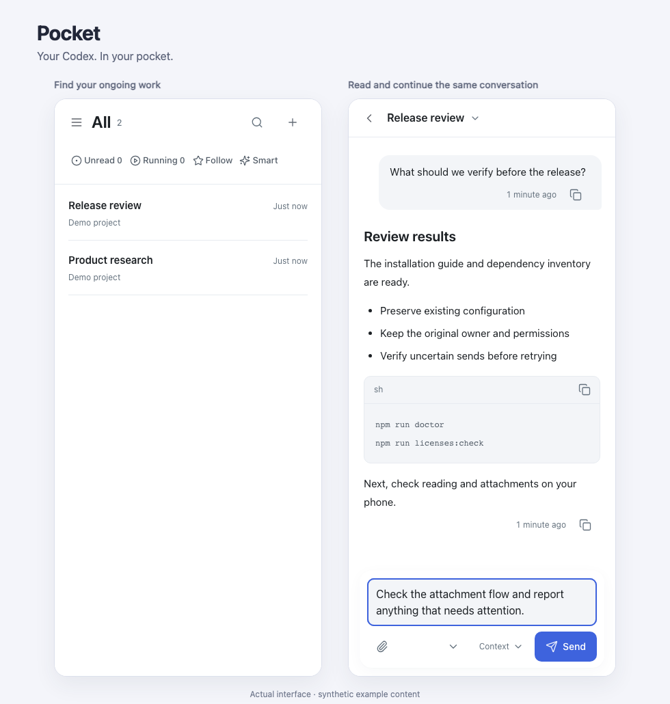
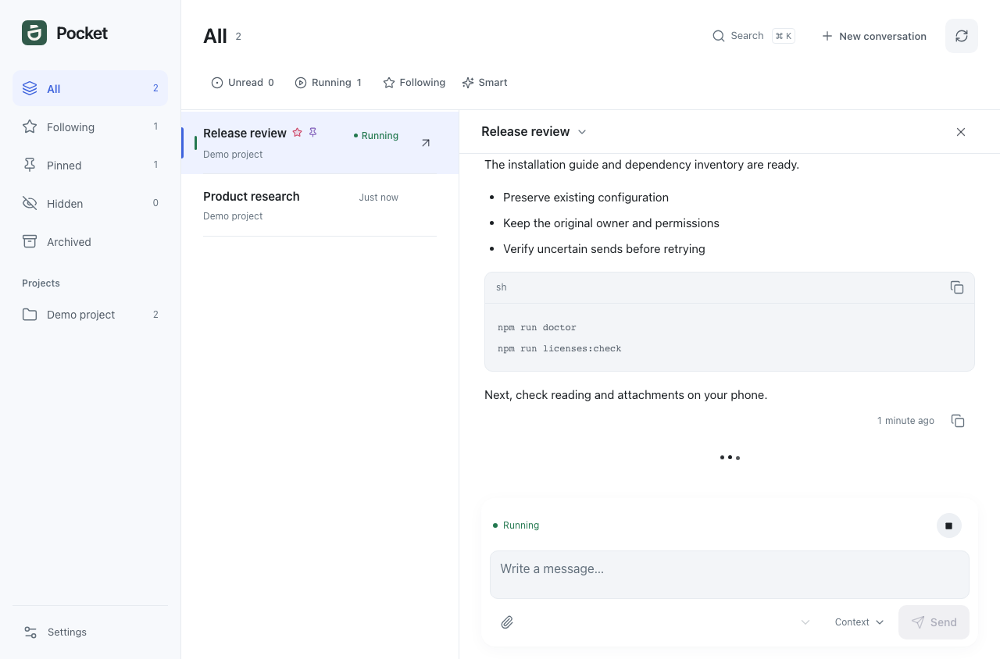
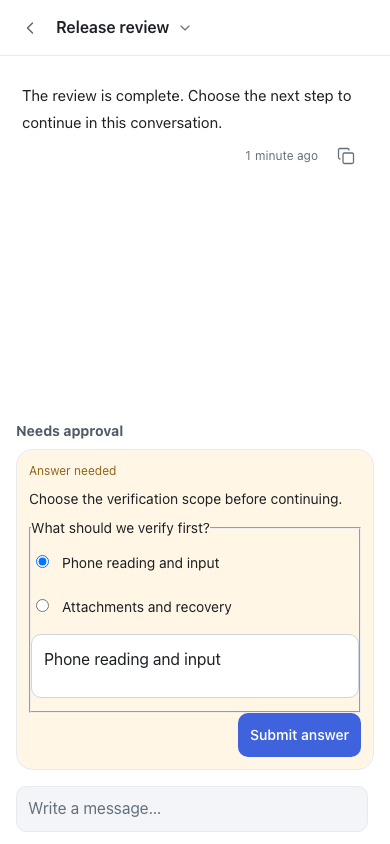

# Pocket

[简体中文](README.md) · English

> **Your Codex, in your pocket.**

Continue your Mac's Codex work from a phone or browser: follow progress, read results, add instructions, send attachments and answer questions. Execution stays on the original Mac.

**Alpha · macOS · PWA · One owner · [MIT](LICENSE)**



## Why choose Pocket

You already use Codex on your Mac for code, research and documents. Pocket keeps that work within reach when you leave your desk.

- **Continue existing conversations:** retain the model, working directory and permissions while keeping your desktop routine.
- **Read and act on your phone:** long replies, code, diagrams and file previews; protected drafts, attachments, questions and approvals.
- **Own your entry:** self-host the browser/PWA service, manage its storage and adapt the interface source.

<details>
<summary>More runtime screenshots: desktop workspace and phone questions</summary>





</details>

## Choosing a solution

| Solution | Workflow focus |
| --- | --- |
| **Pocket** | Existing Mac Codex Desktop conversations + self-hosted browser/PWA |
| [Official ChatGPT / Codex Remote](https://learn.chatgpt.com/docs/remote-connections) | Official cloud/connected-computer tasks, approvals and results |
| [HAPI](https://github.com/tiann/hapi) | Terminal agents, Hub/Runner and phone/Web continuation |
| [Happy](https://github.com/slopus/happy) | Multiple agents, native mobile, shared sessions and content encryption |
| [T3 Code](https://github.com/pingdotgg/t3code) | Unified coding workbench, Git/worktrees and access across devices |

The [detailed comparison and sources](docs/ALTERNATIVES.md) also cover Codex Mobile Bridge, CodexMonitor and remote desktop.

## Quick start

Have Codex Desktop installed and signed in, Node.js 26.x and Python 3.11+. Keep the Mac online and the desktop app running.

```sh
npm ci --registry=https://registry.npmjs.org
npm run setup
npm run build
npm run doctor
npm start
```

On your Mac, open [127.0.0.1:4397](http://127.0.0.1:4397) and sign in using the passphrase file identified by the startup output.

Connect your phone through your own HTTPS proxy or Tailnet entry. See [installation and background service setup](docs/SELF_HOSTING.md), or [give setup to an Agent](docs/SELF_HOSTING.md#set-up-with-an-agent). For an existing installation, follow the [upgrade guide](docs/UPGRADING.md).

## Documentation

[Compatibility](docs/COMPATIBILITY.md) · [Architecture](docs/assets/pocket-architecture.html) · [Development](docs/DEVELOPMENT.md) · [Contributing](CONTRIBUTING.md) · [Privacy](PRIVACY.md) · [Security](SECURITY.md) · [Third-party notices](THIRD_PARTY_NOTICES.md)
