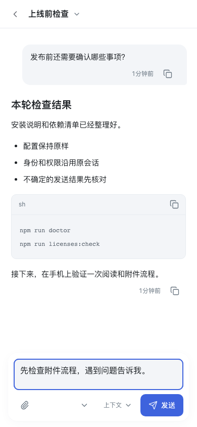

# Pocket

简体中文 · [English](README.en.md)

> **把 Codex 装进口袋。**
>
> 电脑继续干活，手机接着聊。

Pocket 把 **Mac 上已有的 Codex 会话**带到浏览器和手机 PWA：看进展、读结果、补一句指令、发附件、处理问题与审批。任务继续由原桌面会话执行，沿用原模型、工作目录和权限。

[看看运行界面](#运行截图) · [为什么做-pocket](#为什么做-pocket) · [和其他方案怎么选](#和其他方案怎么选) · [开始安装](#先在-mac-上运行)


## 为什么做 Pocket

Codex 在电脑上处理的事情越来越多：写代码、做调研、整理文档、制作文件，很多会话会持续很久。离开电脑时，我们仍想知道它做到了哪里，在需要时补一句话，或回答一个问题；回来后继续同一件事。

Pocket 从这个日常需求长出来。它选择 **已有的 Mac Codex 桌面工作流作为源头**，把找会话、长文阅读、Markdown/代码/图表与文件预览、输入和受支持的操作整理成适合手机的入口。你可以自持网页/API/HTTPS 入口，查看源码，按自己的阅读与操作习惯修改它。

它的选择理由集中在一起：

- **沿用正在使用的工作台**：读原会话、按原 thread ID 查找桌面执行者，保留原模型、目录和权限；手机接续不用先改变日常启动习惯。
- **浏览器就是入口**：手机、平板或另一台电脑可以打开自己部署的网页；手机可添加到主屏幕。安装门槛和运行维护由自己掌握。
- **围绕长期工作阅读与继续**：项目/关注/状态帮助找回任务，结构化正文和文件预览帮助看懂结果，草稿、选区和阅读位置的保护减少切换时的中断。
- **发送和执行各有回执**：已接收与模型完成分开显示，不确定结果按原请求核对，防止重发和迟到响应覆盖新输入。

这些是 Pocket 的产品取舍和实现重点，不是“只有 Pocket 才能做到”的声明。官方 Remote 和其他开源工具也能接续已有任务；如果现成方案已经满足你的需要，优先用它会省去自部署维护。

## 运行截图

下面是 **真实编译应用的运行截图**，使用合成会话和演示问题，不是设计稿，也不包含私人聊天。中英文界面使用同一套功能。

**桌面：按项目找会话，查看运行状态，与手机继续同一段工作。**


| 手机上阅读和输入 | 手机上回答问题 |
| --- | --- |
|  |  |

## 和其他方案怎么选

按 **2026-11-13 的官方文档与源码**核对；没有做竞品实机排名。比较的是工作流与取舍，功能会继续变化。

| 方案 | 更适合的工作流 | Pocket 的选择位置 |
| --- | --- | --- |
| [ChatGPT / Codex 官方客户端与 Remote](https://learn.chatgpt.com/docs/remote-connections) | 官方 Chat、Work、Codex 体系；Remote 已能接续连接电脑的既有会话、审批、看输出与 diff，是否可用取决于 rollout 和 workspace 设置 | 希望自持浏览器/PWA 服务、入口和界面源码，围绕 Mac Codex 会话定制个人体验时考虑 Pocket；官方通路满足需求时更省维护 |
| [HAPI](https://github.com/tiann/hapi) | 从官方 agent wrapper、Hub/Runner 出发，把终端与手机/Web/原生客户端连接起来；已支持 Codex 桌面历史发现、导入、同步与恢复 | Pocket 主入口直接面对已有 Mac Codex Desktop 列表与原桌面执行归属；不把 HAPI 的已有会话能力误说成缺失 |
| [Happy](https://github.com/slopus/happy) | 原 CLI 加上 Desktop/Agent、原生手机与 Web、多模型、多人及内容端到端加密路线 | Pocket 聚焦单个拥有者的 Mac Codex 浏览器体验；原生手机、多模型、多人或 E2EE 是不同需求，不是 Pocket 当前支持承诺 |
| [T3 Code](https://github.com/pingdotgg/t3code) | 统一 coding-agent 工作台，围绕 server/provider 管理执行环境、Git/worktree、桌面/Web/原生手机；已能导入并继续既有会话 | 日常仍以已有 Codex Desktop 为中心时，Pocket 提供阅读与继续入口；希望换到统一编码工作台时，优先比较 T3 Code |
| [Codex Mobile Bridge](https://github.com/try2love/codex-mobile-bridge) | 原客户端远端接续，当前已扩展多个客户端、桌面网关、原生手机和浏览器；与 Pocket 有直接重叠 | 是最接近、值得一起比较的开源方案。Pocket 选择 Mac Codex + 浏览器/PWA 的较窄范围，价值要靠具体阅读、输入、恢复体验验证 |
| [CodexMonitor](https://github.com/Dimillian/CodexMonitor) | Tauri 多工作区/多 agent 工作台，按 workspace 管理 app-server、Git/文件和可选远端 daemon | 更偏完整桌面编排；Pocket 主要给原桌面工作流增加手机与浏览器入口 |
| 远程桌面 / SSH + tmux | 直接操作整台电脑，或继续终端中的工作；适合希望复用完整桌面或 headless 环境的人 | Pocket 把会话与结果重新排成触控界面；完整桌面操作和纯 CLI/SSH 仍是另一种选择 |

“能看到旧历史”“恢复同一个线程”和“接续正在运行的原桌面执行者”是不同层次。HAPI、Happy、T3 Code 已有导入或恢复路线，不能简单说它们要从零重开；Pocket 也不宣称完整同步桌面队列/已读或在所有环境下比它们更好。来源、版本与比较边界见[详细对照](docs/ALTERNATIVES.md)。

## 能做什么，支持到哪里

当前为 **0.1.0-alpha.1** 实验源码，采用 [MIT 许可证](LICENSE)。这是非官方项目，与 OpenAI 没有隶属或背书关系；截至 2026-11-13，尚未发布公共 release。

- 阅读和搜索原会话，按项目浏览，按智能、创建或活动排序；Pocket 的关注和隐藏独立于 Codex 的置顶与归档。
- 继续原会话、上传图片/文件，对受支持的审批与提问作答；保留原请求编号，处理待发和未知结果。
- 查看模型设置，执行受支持的新建、改名、归档和恢复。操作是否可用取决于原桌面协议与会话占用。
- 英文和简体中文默认跟随系统，可添加到手机主屏幕；阅读缓存和界面状态按电脑与来源隔离。

当前支持目标是 **macOS、一个拥有者、自己的 Mac 和手机**，原生验证以 Apple Silicon 为主。Pocket 不提供模型账号或订阅，也不提供多用户权限隔离。它的待发队列与桌面队列独立，原生已读写回尚不稳定，跨手机已读同步未实现；桌面持有会话时，归档等操作可能等待。

独立新 Mac 首装、Intel 和实体手机上的键盘、锁屏通知及长期切网仍待验证。已有部署与合成测试提供局部证据，不能证明任意环境即装即用；这些缺口明确限定 Alpha 的支持承诺，不妨碍公开和试用实验源码。完整边界见[兼容范围](docs/COMPATIBILITY.md)。

## 先在 Mac 上运行

需要 macOS、**Node.js 26.x + npm、Python 3.11+**、已安装并登录的签名 Codex.app，以及兼容的本机会话数据。Mac 需保持在线；原会话控制需要桌面端运行。桥接代码随源码提供，无需维护者的 FBT 工作区。

在你取得并审查的源码目录中运行（已有安装先读[升级指南](docs/UPGRADING.md)）：

```sh
npm ci --registry=https://registry.npmjs.org
npm run setup
npm run build
npm run doctor
npm start
```

在 **Mac 本机**打开 `http://127.0.0.1:4397`。启动输出受保护口令文件的路径；在本机读取并登录，勿将口令粘贴进公开反馈。`doctor` 检查环境与来源，不验证真实发送或手机连接。用 Ctrl+C 停止前台服务。

默认配置保存在被 Git 忽略的 `.local/pocket/`，数据在源码外的 `~/Library/Application Support/CodexNavigator/`，原 Codex 来源为 `~/.codex/`。`setup` 不覆盖已有配置；已有配置时新参数不会生效。

## 再接入手机 HTTPS

手机上的 `127.0.0.1` 指的是手机。你需要自己的 HTTPS 域名/反向代理，或手机可访问的私有 Tailnet HTTPS 入口，转发到 Mac 的 `127.0.0.1:4397`。

新安装已有 HTTPS 入口时，将上面的 setup 一步改为：

```sh
npm run setup -- --public-origin https://pocket.example.com
```

已有安装则编辑所选私人配置中的 `client.publicOrigin` 与 `deployment.publicOrigin`，使它们一致，再重启自己确认归属的 Pocket 服务。保留认证、Host、Origin、CSRF 校验及 loopback 监听。

手机打开自己的 HTTPS URL，登录后通过 Safari 的“分享 → 添加到主屏幕”或浏览器支持的安装入口使用。可复制的 Caddy 配置、验证顺序、后台服务和排障见[中文自部署指南](docs/SELF_HOSTING.zh-CN.md)／[English guide](docs/SELF_HOSTING.md)。每台 Mac 使用自己的配置、数据和认证；Cloudflare 多机中继是额外配置的高级选项。

## 系统怎样运转


[可探索的架构图](docs/assets/pocket-architecture.html)可下载后在浏览器打开。

手机 → 自有 HTTPS 入口 → Mac 上的 Pocket API → 原 Codex 桌面会话。API 只监听 loopback，读取本机历史，保存自己的偏好、待发消息和附件；模型请求仍由原 Codex 执行。Pocket 不直接改写 Codex SQLite、全局状态或 rollout，不另起执行器接管会话。

HTTPS 保护传输；TLS 终止代理可以看到经过它的内容。Pocket 没有额外的应用层端到端加密或数据静态加密，模型请求沿用原 Codex 账号与提供方规则。

## 私人数据与维护

| 内容 | 默认位置 |
| --- | --- |
| Codex 原会话、历史与账号资料 | `~/.codex/` 及 Codex 自己的存储 |
| Pocket 偏好、队列、回执、附件和认证 | `~/Library/Application Support/CodexNavigator/` |
| Pocket/桥接配置与服务日志 | `.local/pocket/` |
| 阅读缓存、界面偏好及可选反馈草稿 | 当前浏览器/PWA 的站点存储 |

以上均不属于公开源码。自定义数据、凭据和备份放在源码之外；已有私有配置按原路径保留，勿用 example 覆盖。普通未发送 Query 留在页面内存，提交到待发队列后才在 Mac 持久化。分析和反馈默认关闭；启用自己的服务前阅读 [PRIVACY.md](PRIVACY.md)。

安装与图片权限排障见[自部署指南](docs/SELF_HOSTING.zh-CN.md)，备份与恢复见[UPGRADING.md](docs/UPGRADING.md)。历史可能保留姓名、会话标识和开发记录，公开范围与旧版本边界见[PUBLIC_HISTORY.md](docs/PUBLIC_HISTORY.md)。源码导出不包含 Git 历史，也不等于全面历史匿名化或已经发布。

普通问题可在你有访问权限的仓库中通过 **Issues → New issue** 报告；仓库目前私有。提供版本、复现步骤和合成样本。安全问题按 [SECURITY.md](SECURITY.md) 请求私下反馈渠道，勿公开秘密或完整聊天。开发与贡献见 [CONTRIBUTING.md](CONTRIBUTING.md)，许可与依赖说明见[第三方声明](THIRD_PARTY_NOTICES.md)。

## 交给 Agent 搭建

将这段和你取得的源码地址或本地目录交给目标 Mac 上的 Agent：

```text
请搭建 Pocket。先读 README、docs/SELF_HOSTING.zh-CN.md、docs/COMPATIBILITY.md、PRIVACY.md 和 SECURITY.md。检查 macOS、Node.js 26.x、Python 3.11+、签名 Codex 桌面端、本人登录及来源布局。使用我提供的源码；缺少源码位置或本人登录时说明所需输入，其余独立工作继续。

先核对已有服务与配置，保留原数据、认证、机器 ID、来源和请求编号，不覆盖配置或启动第二个写入者。新安装依次执行 npm ci --registry=https://registry.npmjs.org、npm run setup、npm run build、npm run doctor、npm start。非默认配置的 setup、doctor、start 全程传 -- --config /绝对路径/config.json；service 命令传 --config，口令维护使用同一路径的 POCKET_CONFIG。setup 不更新已有配置。

先验证本机 /api/health、未登录 /api/catalog 返回401及登录后列表/正文读取。口令只在本机使用，对话和日志只给文件位置。如有我的既有 HTTPS 授权，完成同源反代和手机登录；保持 loopback 与认证、Host、Origin、CSRF 校验。真实发送只用我授权的测试会话，未知结果先查原回执，不能换编号重发。

需要后台服务时先停止前台进程，再用 node bin/pocket.mjs service install --apply，回读 service status；停止并卸载自有后台服务用 service uninstall --apply，数据保留。最后报告版本、入口、配置/数据/口令文件位置、已验证与未验证项，以及停止、备份和恢复方式。
```
