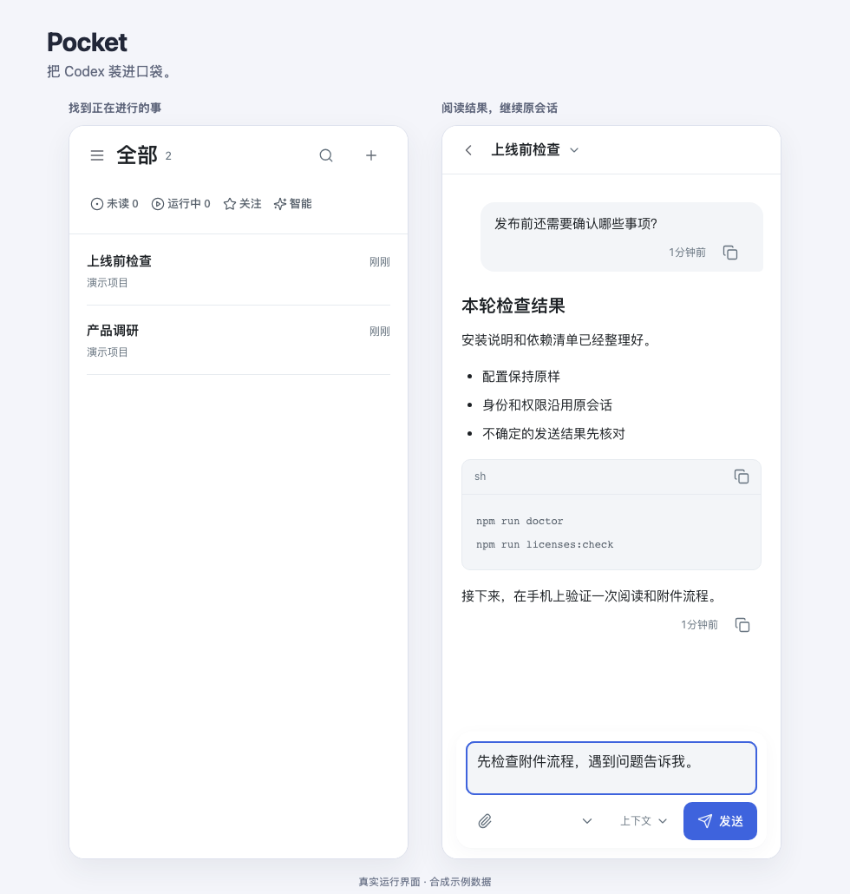
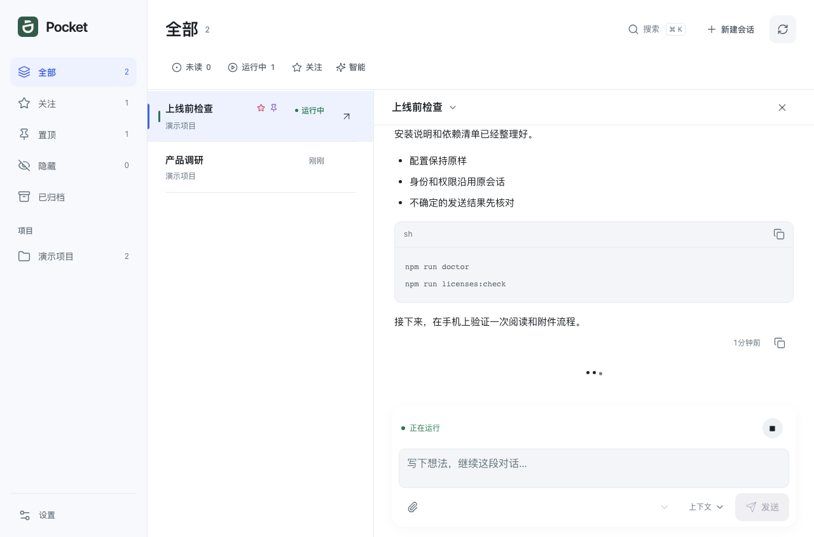
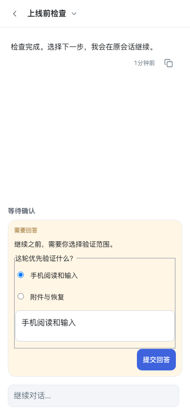

# Pocket

简体中文 · [English](README.en.md)

> **你的 Codex，就在口袋里。**

从手机和浏览器接续 Mac 上的 Codex：看进展、读结果、补一句指令、发附件、回答问题。任务继续在原来的 Mac 上运行。

**Alpha · macOS · PWA · 单个拥有者 · [MIT](LICENSE)**



## 为什么选 Pocket

你已经在 Mac 上用 Codex 写代码、做调研、整理文档。离开电脑后，Pocket 让你继续这份工作。

- **接续原会话**：沿用已有模型、工作目录和权限，保持桌面工作习惯。
- **适合手机阅读与操作**：长回复、代码、图表和文件预览；草稿保护、附件发送、问题与审批。
- **入口自己掌握**：自部署浏览器/PWA 服务，掌握自己的存储和界面源码。

<details>
<summary>更多运行截图：桌面工作台与手机问题处理</summary>





</details>

## 和其他方案怎么选

| 方案 | 工作流重点 |
| --- | --- |
| **Pocket** | 已有 Mac Codex 桌面会话＋自部署浏览器/PWA |
| [官方 ChatGPT / Codex Remote](https://learn.chatgpt.com/docs/remote-connections) | 官方云端与连接电脑的任务、审批和结果查看 |
| [HAPI](https://github.com/tiann/hapi) | 终端 agent、Hub/Runner 与手机/Web 接续 |
| [Happy](https://github.com/slopus/happy) | 多 agent、原生手机、共享会话与内容加密 |
| [T3 Code](https://github.com/pingdotgg/t3code) | 统一编码工作台、Git/worktree 与多端操作 |

[详细比较与来源](docs/ALTERNATIVES.md)另含 Codex Mobile Bridge、CodexMonitor 和远程桌面方案。

## 快速开始

准备已登录的 Codex 桌面端、Node.js 26.x、Python 3.11+。Mac 保持在线，Codex 桌面端保持运行。

```sh
npm ci --registry=https://registry.npmjs.org
npm run setup
npm run build
npm run doctor
npm start
```

在 Mac 打开 [127.0.0.1:4397](http://127.0.0.1:4397)，读取启动输出指向的口令文件并登录。

手机通过自有 HTTPS 反代或 Tailnet 入口连接。设置与后台运行见[安装指南](docs/SELF_HOSTING.zh-CN.md)，也可[交给 Agent 搭建](docs/SELF_HOSTING.zh-CN.md#让-agent-帮你搭建)。已有安装先看[升级指南](docs/UPGRADING.md)。

## 文档

[兼容范围](docs/COMPATIBILITY.md) · [架构图](docs/assets/pocket-architecture.html) · [开发](docs/DEVELOPMENT.md) · [贡献](CONTRIBUTING.md) · [隐私](PRIVACY.md) · [安全](SECURITY.md) · [第三方许可](THIRD_PARTY_NOTICES.md)
