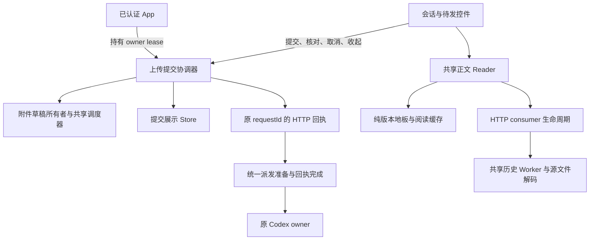

# 独立审查与生命周期归属

2026-11-12。基线 `2f70660f2d3cf640243bae38a60c9bbcc9d7ccd4`，工作区干净。欧吉安要求再次独立 CR 和重构，改善架构与可维护性。本轮覆盖前端提交／附件／认证会话、前后台读取与版本水位、后端派发和回执；没有逐行审查全部源码或改变视觉系统。

## 两条审查线

结构审查关注职责交叉、重复政策、资源归属与类型依赖；契约审查关注原请求／修订／未知结果、消息权威、草稿和读取连续性。两类发现保留各自依据，代码味道不等同于可复现缺陷。第三条后端独立审查检查异步准备与控制操作交接。作者修复后，由其他审查者固定新哈希复验；浏览器验证跨越实际 App 调用链。

| 契约问题 | 原行为与验证触发 | 集中后的规则 |
| --- | --- | --- |
| 确定拒绝的上传没有终结所有者 | HTTP400之后GET not_found无法取消；收起UI后File和轮询仍存活 | reservation phase区分posting／unknown／rejected／reserved；确认拒绝才允许本地取消和重新编辑，收起复用同一清理流程 |
| 登录会话结束，旧上传所有者仍工作 | App在401或退出后卸载，旧Map无法访问但继续GET401并保留File | App持有manager的owner lease；切详情保留，退出释放；StrictMode同步重挂不破坏请求，最后所有者离开终止本地工作 |
| 完整上传后取消排队绕过所有者 | ready不再被算作上传中，Outbox普通删除使旧bundle／claim／轮询保留 | 取消按actual owner分流；完整原件回到草稿，不DELETE附件；恢复失败保留控制，已交付／新claim不重新释放 |
| 前台较新正文没有版本地板 | 前台3→正文淘汰→前台或后台2被允许 | 共享read成功路径观察有效同scope元数据；前后台都拒绝回退，旧服缺元数据仍可读但不猜版本 |
| 异步派发准备之后状态可能改变 | finalize等待时改模型／归档可进入，之后仍send | 准备期间互斥；await后重查管理门槛、当前队头和revision；缺件等待不长期占原生发送锁 |
| 直发和队列的最终回执政策分叉 | 已有实际accepted时，迟到失败留下旧code或丢真实turn通知 | 两条路径使用completeDispatch；持久accepted优先，清诊断、原子出队，失败RPC的诊断turn不作权威 |
| 取消读取只到客户端，没有到Mac队列 | 客户端离开后，压缩／分页仍占pending和Worker队列 | HTTP consumer取消贯通共享reader和解码；最后consumer才取消单job，其他consumer和有效cursor保持 |

## 模块职责

- `queryDraft.ts`和`attachmentTypes.ts`持有纯数据契约，草稿、提问、更新保护等模型不再反向依赖Conversation视图。旧附件类型出口保持兼容，运行时行为不变。
- `attachmentSubmissionManager`管理reservation、取消、恢复、accepted及最终退出；控件只表达意图，不用“是否仍在上传”推断谁拥有请求。恢复进度按已交付的ID记录，不能要求附件一直停留在输入框才能结束。
- `attachments`管理File、upload ID、散列／网络队列和本地资源；dispose取消自己的工作，不清全局共享scheduler，不DELETE远端原件。无法中断的SubtleCrypto结束后也不能回写或启动新PUT。
- `transcriptReader`集中版本证据；`HistoryPageReader`集中单飞、consumer、pending上限和Worker释放，`withReadRequest`只负责HTTP读取者的断开。普通POST／PUT不因网页离开被解释成未送达。
- `DesktopService.requireDispatchReady`与`completeDispatch`收拢真正重复的政策，不为减少文件行数增加透传层。

## 必须保持

原thread ID、owner、模型、目录、权限、requestId、指纹、revision、暂停与FIFO保持。缓存／分页／显示echo不核销发送回执，不标读或取得执行权限。unknown先核对，不自动重放；已发优先于迟到取消或失败。App结束只停止本地工作，已持久提交与未知远端结果仍由原账本恢复。

同scope地板只保存256项标量，不保存正文或能力。缺元数据的旧来源不凭空升级成可验证版本。读取取消不重启共享Worker或旋转有效cursor；原有timeout／Worker fault仍可能整体重置，不能把consumer取消的保证扩成所有失败的保证。

输入框、消息节点、选区、IME、滚动、原视觉、16上传／8预取／8图片／32媒体和2散列预算保持。附件恢复不覆盖新文字或新附件claim；草稿容量不足时保留剩余取回入口。

## 验证与接续

负例／固定源码／独立probe留在 `.local/qa/architecture-cr-2026-11-12/` 的standards、spec、server和reads目录。自动测试采用临时数据库、文件和mock原生IPC；浏览器采用正式CSP与实际App，禁止真实模型、原会话操作或系统权限修改。旧版本负例、设施时序问题、模型回归、浏览器与公网证据分开记录。

最终源码、整仓／浏览器结果、发布和未决项以CURRENT及本轮verification.json为准。本轮不增加依赖、不重新设计UI、不统一清理CSS覆盖层。文件句柄授权验证去重、inline portal焦点回交的重复可在下一次相关能力修改时重开，避免同时扩大控制、读取和视觉范围。

## 同日最终验证与发布

完整2635项测试通过；146个同build浏览器流程由102阅读／输入／导航、38既有上传／图片缓存及6新增认证／ready取消组成。前台地板62、派发142、读取83及session78项各经非作者独立复核，真实Worker单飞／8请求取消／保cursor和真实HTTP断连均覆盖，未动来源文件／数据库。两个旧browser oracle分别要求普通queued阶段不存在的核对按钮、以及给不同body使用同revision；诊断保留，改为真实原ID GET200/accepted与生产内容签名／单调revision，再完整复验受影响场景，未降低原partial／IME／滚动断言。

格得API源a6af18c一次保护切换，原2queued、凭据／偏好／订阅保持，Codex／connector不动。网页源f532021／build4f13d753／Pagesfad7ae04仅上传一次，首次241/243中两项PDF资源network_error，原部署resume复用241后243/243与功能通过；正式重build246文件与已测API内置产物逐字节一致。认证401在上传前，单次原28scope续期并核验目标200。总证据`.local/qa/architecture-cr-2026-11-12/verification.json`，源码身份和独立公网回读以CURRENT为准。

豌豆本次SSH banner超时，未上传或切换，最新22,097,920字节包与SHA保留接续；Documents许可仍待本人。未测试物理iPhone吞吐／挂起／长期使用，不据合成验证宣称全部架构问题已经消失。当前入口缩到必要状态和指针，之前完整接续流水原样归档HISTORY，保留SHA与历史边界。

独立公网version／config／实际App JS三资源最终200与完整字节SHA一致；App JS首次TLS握手失败0字节保留原回执，仅重试同一GET成功，未重部署。重复候选build及被替代的旧豌豆tar已清理约32MB；当前／回退API、依赖、正式dist、最新接续包和必要证据保持。
