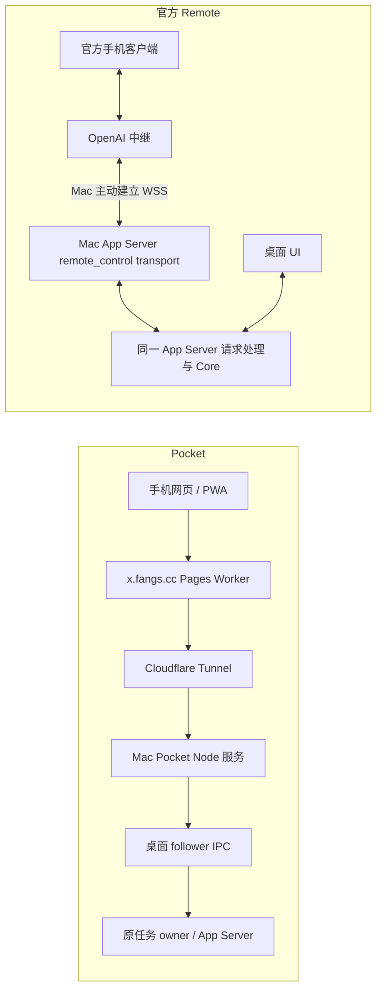

# Pocket 与 Codex Remote：链路、可接能力与产品取舍

核验日期：2026-09-29。本文是源码与官方文档研究，功能候选须讨论后再实施；没有开启官方 Remote、配对设备、修改原任务设置或上传 iOS 构建。同期侧栏文案精简属于用户另行明确提出的界面改动。

## 结论

**大方向相同，具体传输和控制接口不同。** 两者都让手机作为客户端，实际任务在 Mac 的 Codex 中执行，Mac 主动连接中继，所以不要求家里路由器开端口或给 Mac 配固定公网 IP。官方 Remote 是 App Server 的一种远程传输；Pocket 目前是独立 HTTP 服务，通过桌面 follower IPC 找到原 owner 并转发一组有限操作。

这一区别解释了为什么 Pocket 能继续原任务、停止、压缩、回答部分问题，却还不能直接复制桌面的所有按钮。开源协议有某个方法，不代表当前 Pocket 已经获得连接同一桌面实例、调用该方法的可用通道。

**建议继续保留 PWA。** 值得考虑的原生增量是系统分享扩展和快捷指令，而不是再做一份手机聊天列表；详见 [iOS 形态与 TestFlight](2026-09-29-pocket-ios-options.md)。官方 Remote 已覆盖大量基础远控，在扩建前应先比较它在方帅同账号、同 Mac 上的实际表现。Pocket 更独立的价值是跨项目整理、稍后接续、接续说明和待处理事项，而不是功能数追平官方。

## 证据版本与范围

- 本地源码：`/Users/fangs/workspace/study/codex`，origin 为 `https://github.com/openai/codex`；HEAD `1f54845a49475aea60d420a848519b969c03a132`，提交时间 2026-09-10T20:51:16+08:00，工作区干净。
- 本地 HEAD 比当前记录的 `origin/main`（`eb10d91e48ccbd0930427461fb392337addb1ac0`）多一条 `Fix standalone tool output call IDs`。差异涉及历史规范化及测试等七个文件，没有更改本文的 remote_control 传输实现。本次未 fetch，因此不能把该快照称为今日上游最新版。以下 GitHub 固定链接使用所读 origin/main 对应版本；本地证据保留 HEAD。
- `study/codex` 的根 README 是 Codex CLI 项目；包含 Core、App Server、协议及远控 host transport，**不包含足以还原整个官方手机 App、桌面 UI 和云端中继的全部源码**。workspace Cargo 版本为 `0.0.0`，不能用它判定已安装二进制版本。
- 当前安装 `/Applications/ChatGPT.app` 的 plist 实际回读为 `26.903.71938:8576`。只读 bundle 搜索确认 UI 使用 `remoteControl/pairing/start`、`remoteControl/status/read` 和 `remoteControl/status/changed`，主进程通过同一 App Server connection 调用 `remoteControl/enable`。这把开源 host 协议和当前安装版本联系起来，但不等于真实配对验收。
- Pocket 研究基线为 `a5178ba` / `abf82c3`；当前链路由 [MOBILE.md](../MOBILE.md)、[ARCHITECTURE.md](../ARCHITECTURE.md)、`server/desktop.mjs`、`bin/desktop-bridge.py` 交叉回读。

## 两条实际路径

箭头表示消息经过哪些节点，不表示手机能主动穿透 NAT 连接 Mac。Pocket 的 `cloudflared` 主动连 Cloudflare；官方 App Server 主动连官方中继。公网访问的是中继服务，通过已有出站连接返回 Mac。Mac 仍需醒着、联网、后台服务可用。`threads.local` 是本地入口，不因为这个域名本身变成公网可用。

| 层次 | Pocket 当前 | 官方文档 / 本地源码 |
| --- | --- | --- |
| 身份 | Pocket 口令、HttpOnly Cookie、同源/CSRF 检查；隧道登记用独立机器凭据 | 同 ChatGPT 账号和 workspace，host 登记、配对码/二维码、客户端列表与撤销；源码要求 ChatGPT 身份，不支持只用 API key 注册 Remote [S1][S3] |
| 可达性 | Pages Worker 查 KV 中的 Quick Tunnel 地址，转发 HTTP；Mac 连接器续登记 | host 登记取得 server/environment 身份和远控 token，再建立出站 WSS；含 ping/pong、退避重连和认证恢复 [S2–S4] |
| 控制 | HTTP → Python → `~/.codex/ipc/ipc.sock` → 原 owner 的版本化 follower 方法 | Remote envelope 携带 JSON-RPC，通过 `TransportEvent::IncomingMessage` 进入 App Server 的 `process_request` [S5][S6] |
| 状态更新 | 有界历史快照轮询，前台活跃约完成读取后 2 秒再读，空闲 8 秒；落盘历史只读回退 | 双向请求、响应、通知；按 client/stream 分流，包含序号、cursor、ACK、分片重组和有界重发缓存 [S4–S7] |
| 覆盖 | 受当前 follower 方法集、owner 生命周期和 App 版本约束 | App Server 方法更完整；桌面 UI 及账号策略仍会限制可用功能，不能仅从 schema 推断全部可调用 [S1][S8] |

安全措辞：Pocket 的 API 经 Cloudflare 解密/转发，HTTPS 不是应用层端到端加密。官方文档说 secure relay、不直接暴露机器；所读 `remote_control` envelope 直接承载 JSON-RPC，本次没有得到足以证明手机到 Mac 全链路应用层 E2EE 的证据。仓库另有 `exec-server/noise_relay`，不能拿执行器的 Noise 通道替手机 Remote 作证明。

## 能给 Pocket 什么工程输入

1. **更流畅的增量更新。** 原版 `item/agentMessage/delta`、`turn/diff/updated`、`serverRequest/resolved` 等将消息、改动、待处理状态分开更新。Pocket 可先核验原 owner 可订阅的事件，再保留断线后的快照校准；不能只把手机 HTTP 换成 WebSocket 就声称消除了桌面轮询。[S7][S8]
2. **断线恢复要有“收到哪一条”的概念。** 源码的 client/stream ID、seq、cursor 和 ACK 解决传输重放及恢复；它们不等于任意命令已完成，也不保证跨进程重启 exactly once。Pocket 现有持久 requestId、unknown 不自动重放、重读原任务的语义应保留。[S4–S6]
3. **能力按版本与连接实际状态报告。** 把传输、原任务操作、展示分开，避免 UI 看见源码某方法就启用按钮。是否能安全附着当前桌面 App Server、是否有稳定支持的第三方入口，是扩大操作面的首要验证点。
4. **设备配对可替代共享口令。** 官方有独立 host 登记、短期配对码和撤销客户端；如果将来增加原生扩展或多设备，这是值得借鉴的生命周期。它需要新的设备认证设计，不能在本轮研究中悄悄变更已安装手机的登录方式。[S1–S3]
5. **队列可能统一，但需要先验证所有权。** 开源 App Server 有实验性的 `thread/queue/add/list/update/delete/reorder/start`；当前 bundle 还有 `thread-follower-set-queued-follow-ups-state`，内部调用 `acceptFromFollower` 接受目标任务的完整队列。不能假定二者就是同一个稳定数据源，不能把 Pocket 队列整表覆盖过去。应先验证读取、修订冲突、另端编辑、接受后删除及中断暂停；再讨论是否迁移。[S8][S9]

## 桌面能力还可以接哪些

这里的“可接”表示有明确技术路径或证据，不表示已经实现，也不是全量建设承诺。手机价值为产品判断，未做使用频次统计。

| 候选能力 | 手机上的具体用法 | 当前接入判断 |
| --- | --- | --- |
| 图片 / 截图附件 | 直接给任务发一张界面图、报错或拍照材料 | **优先候选。** App Server 输入有 Image/LocalImage，桌面 start/steer 管线有附件；当前桥接主动传空附件。需真实上传到 Mac、回显、失败保留、临时文件清理，手机路径不能当 Mac 路径。普通文档附件另核验 [S10] |
| 更早历史、会话内搜索、定位消息 | 在手机回查先前结论，跳到上次读到的位置 | **现有 owner 路径可继续研究。** bundle 有 `thread-follower-load-complete-history`；分页 API 有 `thread/turns/list`、`thread/items/list`、搜索接口。返回整段历史前先做边界与性能设计，继续按 provenance 过滤注入材料 [S8] |
| 文件改动 / diff / 终端输出 / 图片结果 | 看清改了什么、测试是否成功、错误是什么 | **值得优先做只读结果。** 当前快照有 typed items，协议有 `fileChange`、`commandExecution`、diff 更新；需要有界的单文件/单条展开和路径检查。不是复制完整手机 IDE [S7][S8] |
| 完成、失败、等待我处理的通知与集中视图 | 离开页面后知道何时回来，统一处理多个任务 | **产品价值高，需后端事件来源。** 官方 Remote 提供通知；PWA 也能 Web Push。先核验真实状态和已在另一端处理的消失语义；不是装成原生才可做 [S1][S7] |
| 剩余问答和审批类型 | 文件写入审批、权限请求、MCP 表单、阻塞式提问 | **现有 follower 有对应方法。** 命令审批和异步问题已做，其余需按不同 schema 显示真实请求并核验过期，不能套成一个“全部允许”按钮 |
| 模型、思考强度、Plan / 工作模式 | 手机上为下一轮切换适合的模型或进入规划 | **现有 follower 路径存在。** `thread-follower-update-thread-settings` 有 next-turn 与 active-turn 分支；需按该 host 的有效模型列表与可选组合展示，并区分下一轮设置和当前权限。不能顺手改变默认模型或权限 |
| 编辑上一条消息并重跑 | 纠正刚发出的需求或引用 | **接口存在，语义须先选定。** `thread-follower-edit-last-user-turn` 不等同普通文本编辑，可能回滚后续对话；不要把“编辑”伪装成无后果的改字 |
| 与桌面共享待发队列 | 手机排队的内容在桌面也能看见、编辑和删除 | **有新线索，尚未验证。** 需要队列迁移与多端冲突处理；当前 Pocket 队列仍独立，不能宣称同步已完成 [S9] |
| 新建、重命名、归档/取消归档、分叉任务 | 手机独立开工并整理原任务 | **需求明确、协议齐全，当前控制通道仍受限。** App Server 有 start/name/set/archive/unarchive/fork；现有 follower 没有相应操作，桌面 App Tools 的团队签名链检查不能靠自己的证书解决。应先打通受支持的原实例连接，不另起执行器冒充接入 |
| 项目/工作树、代码 review、终端交互 | 为新工作选择目录与工作树，查看 review 或输入终端命令 | **第二阶段。** 涉及更多会话/进程所有权和环境语义，先解决可读结果与原任务创建，手机上不必把全部桌面面板搬过来 [S8] |
| 自动化/长期目标、Skills/MCP 管理、实时语音 | 手机上查看自动化状态、选择 Skill、语音接续 | **后续候选，分别研究。** 源码有 goal、skills、MCP、realtime 等接口，不等于当前 IPC 或账号可用；自动化调度还有桌面应用层，不能用通用 App Server 列表证明完整支持 |

建议讨论的先后顺序：**单图附件 → 只读改动与结果 → 更早历史/定位 → 待处理与通知**。新建/重命名/归档单列为控制通道验证，成功后再确定交互；官方共享队列作为可靠性课题单列，不借日常打磨直接迁移。上下文用量/压缩、停止、Pocket 排队和部分问题响应已实现，不重复列为新增。

## 原生与 TestFlight

保留 PWA 并不妨碍做轻量原生配套入口。真正值得验证的是：**在其他 App 分享链接/图片 → 选择原任务 → 加一句要求 → Mac 接收**；其次是 App Intents 接入快捷指令和动作按钮。只包 WKWebView，仍保留大部分网页输入与生命周期问题，收益有限。

TestFlight 可以只建内部组并加入自己，不公开上架；需要有效 Apple Developer Program 与有 App 访问权限的 App Store Connect 身份。每个构建最多 90 天，需要持续更新。原生不会让离线/休眠 Mac 执行，也不会解除桌面接口限制；通知在 iOS 16.4+ 主屏幕 PWA 已有官方支持。完整 Apple 来源、条件和未验证项见 [iOS 研究](2026-09-29-pocket-ios-options.md)。

## 固定来源

- [S1] [OpenAI Remote connections](https://learn.chatgpt.com/docs/remote-connections)，2026-09-29 实际读取；配对、同账号/workspace、在线主机、能力与 rollout/admin 边界。
- [S2] [protocol.rs](https://github.com/openai/codex/blob/eb10d91e48ccbd0930427461fb392337addb1ac0/codex-rs/app-server-transport/src/transport/remote_control/protocol.rs#L1)，enrollment/pairing/envelope；215–254 行生成登记、续期、配对与 WSS URL。
- [S3] [auth.rs](https://github.com/openai/codex/blob/eb10d91e48ccbd0930427461fb392337addb1ac0/codex-rs/app-server-transport/src/transport/remote_control/auth.rs#L33)，身份要求；[remote_control_processor.rs](https://github.com/openai/codex/blob/eb10d91e48ccbd0930427461fb392337addb1ac0/codex-rs/app-server/src/request_processors/remote_control_processor.rs)，enable/disable/status/pair/client revoke。
- [S4] [websocket.rs](https://github.com/openai/codex/blob/eb10d91e48ccbd0930427461fb392337addb1ac0/codex-rs/app-server-transport/src/transport/remote_control/websocket.rs#L150)，状态、cursor、ACK；1255–1309 行认证握手与订阅游标。协议版本 3，ping 10s、pong timeout 60s、重连退避上限 30s。
- [S5] [client_tracker.rs](https://github.com/openai/codex/blob/eb10d91e48ccbd0930427461fb392337addb1ac0/codex-rs/app-server-transport/src/transport/remote_control/client_tracker.rs#L138)，初始化、连接复用、按序号丢弃重复输入、IncomingMessage 路由及返回 channel。
- [S6] [app-server/src/lib.rs](https://github.com/openai/codex/blob/eb10d91e48ccbd0930427461fb392337addb1ac0/codex-rs/app-server/src/lib.rs#L1040)，TransportEvent 进入同一 processor。
- [S7] [协议通知](https://github.com/openai/codex/blob/eb10d91e48ccbd0930427461fb392337addb1ac0/codex-rs/app-server-protocol/src/protocol/common.rs#L1844)，任务/turn/delta/usage/diff/请求解决等通知。
- [S8] [协议请求](https://github.com/openai/codex/blob/eb10d91e48ccbd0930427461fb392337addb1ac0/codex-rs/app-server-protocol/src/protocol/common.rs#L510)；[官方 App Server 文档](https://learn.chatgpt.com/docs/app-server)，2026-09-29 实际读取。schema 证明接口定义，不能证明 Pocket 已接通。
- [S9] 本地 `codex-rs/app-server/README.md:886–906` 队列说明（上文版本快照）；已安装 `app.asar` 中 `thread-follower-set-queued-follow-ups-state` 的处理分支，实际调用 `turnCoordinator.acceptFromFollower`。没有调用该操作。
- [S10] [UserInput](https://github.com/openai/codex/blob/eb10d91e48ccbd0930427461fb392337addb1ac0/codex-rs/app-server-protocol/src/protocol/v2/turn.rs#L394)，图片、文字及其他输入类型。

当前桌面接口限制的旧证据：[签名边界](2026-09-28-peer-signing-boundary.md)、[改名与连接原任务](2026-09-29-rename-and-open.md)。本轮重新核对了安装版本与 follower 方法集合，但没有尝试绕过校验。官方账号可用性、手机配对后跨网恢复、原生真机/TestFlight 体验全部仍待实际验证。
