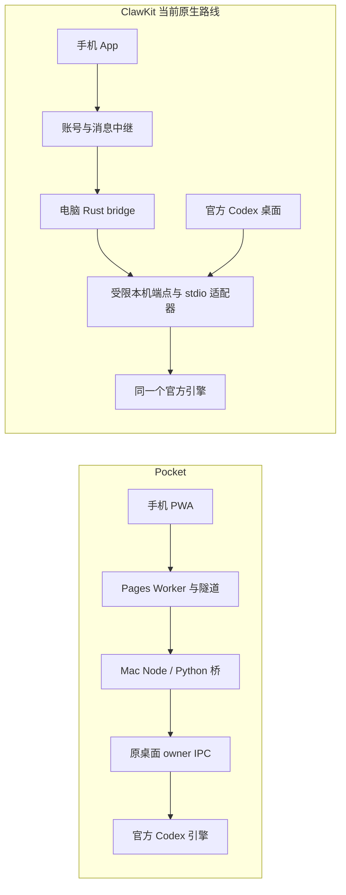

# ClawKit 与 Pocket：手机怎样接续电脑上的 Codex

2026-10-13。范围是 **ClawKit Desktop 3.19.52 + ClawKit 远程助手 Mobile 0.1.35**，与本仓库当前 Pocket 比较。只读核对相关源码、文档与既有验收；本轮没有运行两产品的发送、审批、标读或安装流程。研究建议未转为开发任务。

## 各自是什么

**ClawKit** 这组产品让用户在电脑和手机登录同一账号，在手机选择执行电脑、查看 Codex 项目与对话、继续任务。桌面包基于 CC Switch 的 Tauri / React / Rust 工程，另有可选的模型配置能力；手机是 React Native / Expo 应用。远程接续可以沿用电脑已有的 Codex 模型与认证，无需先改用 ClawKit 模型服务。[C1–C3]

**Pocket** 是方帅个人 Mac 上 Codex 的手机 PWA 入口：打开网址或主屏幕图标，查看原任务、发送或排队、处理支持的问题与审批、上传附件，以及新建、改名和归档。Mac 上的 Node/Python 服务负责连接原 Codex；目前服务一个本机来源，没有多电脑选择与统一账号平台。[P1–P3]

两者的交集很大，模型调用、工具执行和任务文件都留在执行电脑。ClawKit 的主要增量是账号与设备入口、较完整的历史定位，以及接入同一引擎后的事件与请求处理。Pocket 已覆盖大量日常接续，并在待发编辑、停止后暂停队列和原会话管理上形成了自己的完整流程。**建议借具体机制，暂不整体替换 Pocket。** 这里的判断针对当前用途，不是对两产品整体质量或市场需求的排名。

当前替代性还有一个具体前置问题：ClawKit 的已读实现不支持 Pocket 当前使用的 API-key 身份，但手机从列表/搜索进入详情前会等待标读成功。因此，这套配置可能连首次打开旧任务都会报错，不能只理解为蓝点不同步。这是代码调用链推断，尚未实机复现；应先验证这个最小读取动作，再比较发送体验。[C9]

ClawKit 是多产品名称：主仓地图还列有 HITL Connect、ClawKit Connect、HTTP 连接器和模型网关。本次读取 Windows 使用的 SSH/SFTP 能力属于 HITL 工具链，不能算作 ClawKit 手机远程助手已经提供的终端或文件管理功能。

## 最关键的实现区别：怎样接上原任务

### Pocket：连接已运行的桌面 owner

手机请求经过公开入口、Mac API 和 Python 桥接，按原 thread ID 寻找桌面 owner，再使用其 start / steer / interrupt 等操作。原模型、目录与权限沿用；历史能读不自动授予发送权。[P2]

“不另起执行器接管既有任务”准确；“完全不启动 app-server”不准确。Pocket 新建空任务、改名等管理操作使用短生命周期官方 CLI/app-server；新任务第一条执行仍交回原桌面。[P3]

### ClawKit：当前需要区分三条路线

| 路线 | 当前证据与用户影响 |
| --- | --- |
| 原桌面 IPC 接续 | 通过 Rust bridge 查原 owner，按需深链加载任务，直接续聊。功能受原 IPC 能力限制；Windows 自动加载原桌面对话仍明确返回不支持。 |
| 同一引擎的原生适配器 | 通过 ClawKit 的“打开 Codex”入口，仅为本次启动设置 `CODEX_CLI_PATH` 等环境。适配器透传桌面原参数，启动**这次官方桌面所使用的那个官方引擎**，复用其 stdio，并提供受限本机 socket / Windows named pipe。手机与桌面共同访问这个引擎，从而支持事件、原生新建、停止和更多人机请求。 |
| 历史独立 app-server 路线 | 旧文档、兼容/测试代码及可选 helper 中仍存在；不应拿这一路的功能和验证概括当前默认的 `desktop-owner` 流程。 |

原生路线不会把一个正在工作的普通 Codex 进程就地改造成共享引擎。启动器检测到 Codex 正在运行，会要求先正常退出；不会自行结束原任务。它改变下一次启动时的接入方式，兼容性与维护成本高于只连接当前 IPC。当前正常 UI 已引导使用这一入口，新建也已改为原生接口，旧 README 的“必须解锁电脑并授予辅助功能权限”不能代表这个新分支。[C2–C4]

该图描述源码中的职责，不证明线上部署或所有平台已完成验收；ClawKit 的 IPC 回退路线未画入图中。

## 按实际操作比较

表中“源码”表示入口与实现已查到；真实效果是否经过验收，另见下一节。不能仅因服务声明 capability=true，就认定该设备能完成操作。

| 用户操作 | Pocket 当前行为 | ClawKit 当前行为及限制 |
| --- | --- | --- |
| 第一次用手机连接电脑 | 单口令登录个人 PWA；Mac 服务、Codex 与隧道需可用。部署仍有个人路径和基础设施依赖。[P1、P8] | 系统浏览器统一登录，选电脑；桌面登录并启用远程。手机生产入口隐藏服务地址；模型服务配置可选。账号、中继与客户端安装是额外依赖。[C1、C2、C5] |
| 继续原任务 | 找原 owner，保留 thread、模型、cwd、权限；显式恢复可请求原桌面打开该任务。[P2] | IPC 路线找原 owner；原生路线加入同一官方引擎。`desktop-owner` 不等于“一定仅走 IPC”。重新连接不会自动降级到独立执行模式。[C3、C4] |
| 运行中补充、下一轮再做、停止 | 默认入 Pocket 持久队列，可编辑、删除、直接追加当前轮；停止绑定当前 turn，并暂停队列，之后可恢复。[P2] | 支持当前轮 steer；原生模式支持停止。Rust 有独立持久队列，但 **0.1.35 的 `queueing=false`，唯一正常发送调用传 `queue=false`**，当前主界面未提供新入队入口，只显示/取消已有队列项。不能把后端队列等同 Pocket 完整待发体验；两者队列都不等于 Codex 桌面队列。[C6] |
| 新建、改名、归档 | 已接入原任务新建、原名称修改、归档/恢复；writer 占用会使归档等待。分叉/工作树未交付。[P3] | 在已选电脑原项目内原生新建，需适配器就绪。当前手机与 bridge 路由未暴露原任务改名、归档/恢复；任务目录排除归档及子代理。[C3、C7] |
| 找项目和任务 | 导入原项目归属、搜索标题/项目/目录；Pocket 自设 pin 不反写桌面 pin。[P1] | 按电脑读取目录与项目；项目视图和活动视图，等待/未读/运行分类及最近回复摘要。其活动视图也不是官方窗口内存状态的完整跨端镜像。[C7、C8] |
| 找很早以前说过的话 | 读取有界最近历史：rollout 尾部最多 4 MiB，最近 80 条、单条 24,000 字符、合计 160,000 字符；未提供对话正文搜索与完整早期分页。[P4] | 有保存历史的游标分页、已发送消息列表和历史用户消息搜索，结果可跳转匹配页；原生引擎历史另用 `engine:` 游标。搜索索引按需建立，初次未完成时应展示进度；不等于所有角色的全文搜索。[C8] |
| 手机读完，电脑蓝点消失 | 前台看到最新观察版本后，凭绑定身份/host/内容版本的观察凭据请求原生标读并回读。**当前实现只支持 API-key/local 身份**。[P5] | 通过原生 IPC 标读并等待原存储确认；**当前 `unread.rs` 解析 ChatGPT token 身份，不覆盖 API-key 模式**。手机进入详情前等待标读，因此 API-key 下首次从列表/搜索打开旧任务可能报错（源码推断，未实机复现）。Windows 已有 IPC 初始化记录，已读回执实测因缺少 ChatGPT 身份未完成。[C9] |
| 回答问题、批准操作 | 异步/同步问题及命令、文件、本轮权限请求有实现；MCP 自定义表单等回电脑。只开放当前支持的单次/本轮响应，不接入所有长期授权选项。[P6] | 同一引擎模式有命令、文件、权限、同步问题及部分 MCP 表单处理，支持原请求允许的 session/规则选项；URL 身份验证仍在电脑。按 engineInstanceId 与原请求仲裁，避免两端重复回答；这些操作依赖原生连接。[C10] |
| 临时断线，回来继续 | 落盘正文、owner 状态与持久 outbox 分开；45 秒有界恢复、requestId 回执查询；unknown 不自动重发。[P2、P7] | 同账号连接重新取 ticket、退避重连、事件补读和请求编号恢复；编号先写 SecureStore 再发送，unknown 只查询。切电脑按账号/服务/设备隔离；系统安全存储不可用时不降级丢掉防重编号。[C5、C11] |
| 写一半，切任务或杀掉 App | 普通文字/问题草稿主要在页面内存；跨视图可保留，关闭、刷新或系统回收后不保证恢复。Mac 队列与已上传附件各有独立恢复机制。[P7] | 普通文字/附件草稿也主要在 React state/ref，切电脑可暂存于父组件；并非持久跨设备草稿。源码有每设备最多 20 个、每文件小于约 1 MB 的历史磁盘缓存，但走条件历史分支；原生流式打开路径未写入这套缓存。离线 UI 只允许重看当前已选对话，不能据此承诺离线冷开全部历史。[C11] |
| 换手机、换电脑或账号 | 多浏览器 session 访问同一 Mac；`hostId=local`、网关单 origin。没有多主机入口、租户角色或逐任务授权。[P1、P8] | 手机可选多台注册电脑，记住稳定设备 ID；缓存/请求编号按服务、账号、电脑分区，有连接清单/撤销入口。**这不是把某条任务和文件迁移到另一台电脑**。服务端跨账号隔离与撤销效果，本轮未做线上验收。[C5] |
| 手机把图片、文件交给任务 | 最多 6 个附件/条、每文件 20 MiB；认证上传到 Mac，原 owner 接收；上传与发送分别留编号。上传附件原件可下载。[P9] | 最多 4 个附件/条；普通文件 20 MiB，图片 5 MiB，按块上传。回执确认后交给执行电脑；这不是整个磁盘的同步。[C12] |
| 从手机拿到电脑生成的文件 | 已绑定上传附件可下载，任务内已引用静态图片可看；任意新生成 PDF/ZIP 的本地链接取回尚未覆盖。[P9] | **原生引擎就绪时**可读取任务 cwd 内文件：后端上限 5 MiB，校验路径与分块版本；手机显示 PNG/JPEG 或不超过 1 MiB 的可解码文本。读取 cwd 依赖 native `thread/read`，没有 IPC 回退。`TaskFiles` 只有预览/关闭并清理临时文件，没有通用保存/分享入口，不能算完整 PDF/ZIP 导出。[C12] |
| 看工具执行、模型与权限 | 正文、过程消息、上下文占用和压缩已有；完整工具输出/终端/diff 未交付，手机不切换模型、思考强度或工作模式。[P4、P6] | 原生事件路线显示工具输出与文件变更摘要；已有任务空闲时可从电脑可用列表切模型，权限继续由原请求/电脑配置限定。“执行/规划”选择主要存在于历史独立模式的新建页，不能套用到当前原项目新建。[C3、C10、C13] |
| 手机发命令让远程电脑执行 | Query 交原 Mac Codex 执行；不是通用 SSH、RDP 或手机本地 Agent。[P2] | Query 交所选电脑的 Codex；受限本机端点拒绝任意 `process/spawn`、账号读取与权限覆盖。没有在本次手机产品中查到通用 SSH/SFTP 终端；共享 Windows 的 HITL 接入是另一产品。[C4] |
| 退到后台，等完成通知与更新 | 已实现 Web Push 与安全网页更新；SW 只缓存公开壳，私人 API 仍需联网。真实 iPhone 锁屏通知仍未验收。[P8、P10] | Android 有独立进程前台通知服务、Keystore 加密凭据及任务跳转；iOS 该 native module 不可用，不能推导 APNs 已接入。APK 更新核对大小、摘要、包名、版本和签名，再交系统安装器。[C14] |

## 账号、隐私与部署职责

这里有三种不同身份：ClawKit 网站账号、每个客户端设备身份、电脑已有的 Codex/OpenAI 执行身份。统一登录前两者，不自动切换第三者，也不会让 API-key 与 ChatGPT 两种已读存储格式变成同一套协议。[C5、C9]

ClawKit 最新客户端已从旧密码表单切到浏览器 SSO。文档描述 PKCE S256、短期流程、一次性 code/ticket；本轮查到手机对应 start/poll/ticket 和设备选择代码，也查到桌面稳定设备 ID 与账号分区，但未取得并验收线上 SSO/中继后端的全部授权实现，不能把客户端检查当作服务端安全结论。原桌面文档明确中继可见转发内容、不是端到端加密；当前客户端也发送普通协议 JSON。[C5]

Pocket 用 scrypt 校验单口令，浏览器得到独立的 HttpOnly/SameSite Cookie，服务存会话 token 哈希，并校验 Host/Origin/CSRF。此认证保护个人服务，不提供注册、组织、角色或逐任务 ACL。私人存储留在 Mac；流量经过 Cloudflare 转发，不能将“数据主存储在本机”理解成转发方无法接触明文。[P8]

| 部署职责 | Pocket | ClawKit 这组产品 |
| --- | --- | --- |
| 电脑 | Mac Node 26、Python、FBT IPC 依赖，loopback API 与隧道连接器；官方 Codex 执行 | 桌面安装包包含 Rust 桥及适配器；官方 Codex 执行。原生接入有 macOS/Windows 源码，平台验收范围需分别判断 |
| 手机 | 浏览器/PWA；网站更新 | Expo/React Native App；Android APK 已有构建产物，iOS 源码/历史模拟器记录不等于当前 iPhone 真机交付 |
| 公网 | Pages 公开壳 + Worker，KV 登记一个 Quick Tunnel origin，转回个人 Mac | 账号服务 + 设备发现/消息中继；模型网关为可选用途。实际生产服务拓扑、可用性与费用未在本轮核验 |
| 交付现状 | CURRENT 有个人公网发布与回读记录，独立安装/对外分发未完成通用验收 | 有 Windows/Android 安装产物与既有 Windows 升级记录；不等于多设备实际使用、当前 iOS 或所有系统均通过 |

执行电脑睡眠、断网或退出必要进程时，两者都不能凭手机壳继续完成新执行；“网页能开”“已登录”“中继在线”“原任务可执行”是不同状态。

## 验证到底到了哪一层

### 本轮新核对的事实

- Pocket 核查 HEAD：`0ec6c54cb85b563f827e3349fc6f5cce94c1a788`，初始工作区干净。CURRENT 记录的前端部署源码为 `3bede7f9f5d6a7381f8f831ae567b8edfa521229`，Mac API/桥为 `a378cdaf02a4331d0c7bd16bc6142e5bb78cf27b`；研究 HEAD 不等于线上版本。
- ClawKit Desktop 构建回执标注源码 `b22e41d80729aad3266f75b7ca9dae864777f3a0`；Mobile 回执标注 `f46b904e3bd111bc65fec667d1945fb1b05ee109`。这些 SHA 是回执提供的源码身份，本轮没有重建安装包来证明整个构建链。
- 手机源码归档 `C:\self\hang\remote-mobile-035-source.tar.gz` 为 213,466 字节；远端与本地 SHA-256 均为 `b1a232a2fb1daeadcd10793e5e633974592b92dcf3aeb5501e6f019d8cc4aebb`。选取的文本文件与内置 source-manifest 核对一致；没有读取 `.env` 内容。
- Windows 安装包与 Android APK 的远端 SHA-256 分别为 `7e27ab6cb0f364f1eca49de5d573bfc1b62074e6303e565fe67f8f50e6d4b10e`、`42e3678f65eeef759e83e0525c4389e00975b954a37af18b02c37d35fd7c6aeb`，与各自构建回执一致。只证明读到的产物身份，不证明产品体验。
- 读取经现有 SSH/SFTP 完成；未运行安装包、重启服务、改变系统/GPU 配置或参与共享机上的 TTS 工作。没有把其他 ClawKit 产品的能力并入本报告。

### 已有真实记录与尚待验证的部分

| 记录 | 本轮回读到什么 | 不能外推什么 |
| --- | --- | --- |
| Pocket 10-13 原 owner 公网回显 | 原 turn completed、准确回复、0 工具，受保护设置/归档恢复记录；源码与 HISTORY 对齐 | 不代表长期切网、所有账号和 iPhone 主屏幕都通过 |
| Pocket 10-05 恢复与未读 | 原 owner 从不可用到恢复并回显；未读经公网与原生存储回读消除 | 仅该配置/身份；不能外推 ChatGPT 登录模式 |
| Pocket 10-10 附件 | 图片原输入含 localImage 且回复匹配；普通附件字节下载与任务读取通过 | 不代表任意生成物下载已实现 |
| Pocket 审批、通知 | 新类型审批主要是源码/合成验证；既有通知记录明确系统权限 denied、系统通知数量 0 | 不能声称所有审批和真实手机锁屏推送已验收 |
| ClawKit Windows 3.19.52 安装记录 | 10-13 已存回执：静默升级、exit 0、卸载版本与文件匹配；隔离进程 8 秒存活，原官方进程保留 | 同一记录写明 installerWizardTested=false、windowHandle=0、sessionId=0；不是交互式窗口或手机接续验收 |
| ClawKit 10-11 同引擎实验 JSON | 隔离的官方引擎、两个协议客户端、同一完成轮、重连历史与引擎重启后持久化均有记录 | 明确使用合成模型、没有真实桌面 UI/Android 验收；旧原型不是今天完整客户端验收 |
| ClawKit 3.19.51 / 3.19.52 文档 | 声明 macOS bridge 与合成引擎测试、活动列表对照；Windows IPC 初始化通过，已读实测受身份前置条件阻塞 | 文档记录不等于本轮重演；不能把构建、模拟器或 Windows 后台进程当作手机真实操作完成 |

Pocket 私有验证入口：`.local/qa/version-contract-2026-10-12/echo-native-verification.json`、`canary-preservation.json`；`.local/qa/connection-2026-10-05/live-echo.json`；`.local/qa/read-state-2026-10-05/`；`.local/qa/attachments-2026-10-10/`；`.local/qa/controls/native-notification-boundary.json`。仅核对状态、计数、断言与摘要，未复制真实对话。

ClawKit 入口：`C:\self\hang\desktop-352\install-acceptance\result.json`、主仓 `docs/front/codex-native-task-research-2026-10-11.results.json`、桌面 `docs/remote-native-3.19.51.md` 与 `docs/remote-sso-activity.md`。只读源码镜像及精简校验索引保存在本项目私有 `.local/research/2026-10-13-clawkit-pocket/`，不纳入 Git 或公开发布。

## Pocket 值得借什么

| 取舍 | 具体落点 | 判断依据与重开条件 |
| --- | --- | --- |
| **优先借鉴：历史定位** | 搜自己说过的一句话，显示片段，直接跳到那一页；索引尚未完整时说明进度 | Pocket 当前缺早期分页和正文搜索；ClawKit 有完整的路径设计。先选一次真实“找旧要求”的场景，验证是否明显减少找寻时间，再建设索引 |
| **优先借鉴：任务产物入口** | 在原任务中预览文件、明确所属电脑/目录；下载生成物要另做清楚的原件出口 | Pocket 上传已覆盖，取回生成物仍有缺口；可借 ClawKit 的目录限制、分块版本检查，但它本身也未交付通用 PDF/ZIP 导出 |
| **按多主机场景借鉴：目标绑定** | 设备名、系统、在线状态、最近选择；草稿/回执/缓存以服务+账号+执行电脑+thread 绑定 | 用户现在有 Mac 与共享 Windows 的使用背景，但 Pocket 尚无多主机后端。先验证两目标选择和隔离，不因多一个设备页就宣称实现了跨主机执行 |
| **保留已有：接续与可靠提交** | 继续维护原 owner、requestId、unknown 不重放、待发编辑与停止暂停、已读观察凭据 | 这些不是 ClawKit 新增后 Pocket 才需要补的能力；其当前新入队 UI 反而更窄。先解决真实输入/恢复问题，不重复建设同名功能 |
| **研究候选：共享引擎与事件** | 当 IPC 无法支持必要的 MCP 表单、工具结果或事件一致性时，在隔离官方桌面实验薄适配器 | ClawKit 给出可信的工程方向；代价是启动方式、原请求仲裁、版本兼容与退出恢复的持续维护。现有问题/停止可用时，不为“原生”标签迁移整条执行链 |
| **暂缓：整套账号、模型与客户端重写** | 统一账号、模型计费/供应商配置、完整 CC Switch 功能和全量 RN 重写均单独立项判断 | 当前单人单 Mac 用途没有证明这些投入必要；原生 App 也没自动解决文字草稿持久化、PDF 导出或 iPhone 后台可靠性 |

普通未发送草稿的持久恢复是双方共同缺口。若现实中反复丢稿，先让 Pocket 的现有输入生命周期得到可靠存储与清晰恢复，再讨论换客户端技术；“缓存历史”与“保住正在写的内容”需要分开验收。

## 最小验证：建议，尚未执行

1. **先打开旧任务，再做双端往返。** 首先不发消息，在当前 API-key 配置下从 ClawKit 列表及搜索结果进入已有隔离会话，观察是否因标读失败而无法进入详情；单独记录 ChatGPT 身份对照，不能靠换账号掩盖原配置不兼容。读取成立后，再记录 thread、模型、cwd、权限，手机提交唯一标记，桌面继续同一条；运行中分别测试追加与显式排队，再停止。核对每条文字只出现一次、进入预期轮次、停止后待发不会自行执行。ClawKit 分别标明 IPC / 原生路线，不能只测后一条就覆盖前一条；用一条无副作用审批和问题确认请求 ID 与两端状态。
2. **三种状态遇到三种中断。** 准备未发送文字、已上传附件和已受理待发，分别切网、锁屏/后台、强制关闭再开；比较文字、字节与 requestId。另端打开后只对账未知派发。通过条件不是“重新在线”，而是每一项有明确保留/丢失/待核对结果、没有重复执行，并实测通知显示与点击回原任务。
3. **一个输入、三种产物。** 手机上传带唯一标记的 TXT，隔离任务生成 TXT、PNG 和小 PDF/ZIP。手机分别查看和保存，核对原件 SHA-256。预计可直接暴露 Pocket 的生成物出口、ClawKit 的预览/导出区别；以真正拿到需要的文件作为下一步开发依据。
4. **两台电脑、两部客户端。** 在可用的隔离目标上验证选择、重登、离线和撤销；每次提交前后记录目标电脑与原 thread，旧响应不得进入另一设备的任务。没有迁移功能就明确停留在原机器，不自动转发到另一台。共享 Windows 的现有任务继续保留，需改变 Codex 启动方式的实验安排在独立环境。

若先判断 ClawKit 能否替代当前入口，从第 1 项的打开旧任务开始；若继续打磨已经使用的 Pocket，优先在方帅真实手机上做第 2 项，取得最缺的连续性证据。需要历史定位或取回产物时，再以具体对象决定功能投入。

## 源码索引

以下 `P` 路径相对于本仓库，行号固定在研究 HEAD。`D` 相对于 Windows 的 `C:\self\hang\desktop-352`；`M` 相对于已校验的 Mobile 0.1.35 源码归档；`R` 相对于 `C:\self\hang\chat-all`。源码中仍有旧说明，结论优先依当前正常 UI 调用和其后端分派。

| 标识 | 主要证据 |
| --- | --- |
| P1 | `AGENTS.md:3`；`CURRENT.md:15–30`；`server/source.mjs:7–14,89,128`；`docs/ARCHITECTURE.md:11–25` |
| P2 | `server/desktop.mjs:77–157,296–301,493–559,579–619`；`bin/desktop-bridge.py:70–86,532–539,577–619`；`docs/CONVERSATION.md:115–119` |
| P3 | `bin/create-thread.py:51–54,268–302`；`bin/rename-thread.py:25–30,239–250`；`bin/archive-thread.py:150–165,200–227`；`CURRENT.md:53` |
| P4 | `server/history.mjs:13–37,59–69,127–139,194–214`；`docs/DESKTOP-PARITY.md:15–17` |
| P5 | `server/unread.mjs:11–37`；`server/read-state.mjs:44–123`；`bin/read-state.py:37–43,96–126`；`src/readObservation.ts:33–107` |
| P6 | `bin/request_actions.py:13–104`；`src/QuestionPrompts.tsx:16–69`；`docs/CONVERSATION.md:145–151`；`docs/QA.md:165–171,193` |
| P7 | `src/App.tsx:80–83,113`；`src/Conversation.tsx:167–173,404–412`；`server/attachments.mjs:89–92`；`server/desktop.mjs:554–556` |
| P8 | `server/auth.mjs:52–140`；`server/index.mjs:139–218`；`edge/worker.mjs:41–124`；`docs/MOBILE.md:5–13,37–64`；`public/sw.js:73–95` |
| P9 | `server/attachments.mjs:45–107,143–178`；`server/message-images.mjs:48–101`；`src/MessageMarkdown.tsx:12–17,67–78`；`bin/desktop-bridge.py:155–193,602–618` |
| P10 | `server/notifications.mjs:31–45,64–95,105–123,159–174`；`docs/NOTIFICATIONS.md:24–28`；`public/sw.js:26–55` |
| C1 | D `package.json:2–4`；M `package.json:2–3,18–28`、`App.tsx:253–286`、`src/components/AccountWorkspace.tsx:45–88`；R `AGENTS.md` 产品地图 |
| C2 | D `src/components/remote/DesktopConnectionCard.tsx:66–118`；`src/components/remote/RemoteControlPage.tsx:95–118,143–155` |
| C3 | D `src-tauri/crates/desktop-bridge/src/lib.rs:139–183,196–242,275–291`；M `src/services/relaySession.ts:32–54`、`src/hooks/useCodex.ts:97–118`、`src/components/ChatWorkspace.tsx:130–142` |
| C4 | D `src-tauri/crates/desktop-bridge/src/native/launch.rs:3–57`、`native/launch_windows.rs:3–21`、`native/runtime.rs:21–79,93–160,251–278`、`native/mod.rs:64–85`、`version.rs:79–104`；R `docs/front/codex-remote.md:3,85–101` |
| C5 | M `src/services/accountAuth.ts:39–104`、`desktopDevices.ts:8–31`、`remoteAccess.ts:9–21`、`RelayClient.ts:85–118,143–175,246–252`、`App.tsx:227–242`；D `src-tauri/src/clawkit_account/identity.rs:6–45`、`desktop_remote.rs:77–123`、`docs/remote-sso-activity.md:7–9`；R `docs/front/codex-desktop-owner.md:15` |
| C6 | M `src/components/ThreadDetail.tsx:143–145,205–210`、`src/hooks/useCodex.ts:302–310,382`、`src/services/desktopDispatch.ts:32–81`；D `src-tauri/crates/desktop-bridge/src/queue.rs:1–22`、`outbox.rs:44–99`、`native/control.rs:65–93` |
| C7 | D `src-tauri/crates/desktop-bridge/src/catalog.rs:5–15,42–105`；`lib.rs:275–291`；M `src/components/ChatWorkspace.tsx:130–142` |
| C8 | M `src/services/desktopHistory.ts:38–40`、`src/hooks/useThreadSearch.ts`；D `src-tauri/crates/desktop-bridge/src/search.rs`、`saved_history.rs`、`native/control.rs:17–49`、`docs/mobile-history-search.md:3–13`、`docs/remote-sso-activity.md:13–19` |
| C9 | D `src-tauri/crates/desktop-bridge/src/unread.rs:23–60,74–93`、`lib.rs:139–142`；M `src/hooks/useThreadReadState.ts:10–26`、`src/components/ChatWorkspace.tsx:80–89`；D `docs/remote-native-3.19.51.md:3–7` |
| C10 | D `src-tauri/crates/desktop-bridge/src/native/responses.rs:8–70`、`native/runtime.rs:251–268`；M `src/services/remoteControl.ts:4–24`、`serverRequests.ts:6–13` |
| C11 | M `src/services/threadCache.ts:15–51,65–85`、`desktopDispatch.ts:13–81`、`desktopCreation.ts:12–40`；`src/hooks/useCodex.ts:93–118,168–195`；`src/components/AccountWorkspace.tsx:45–57`、`ChatWorkspace.tsx:48–51,80–89` |
| C12 | M `src/services/fileAttachments.ts:6–29`、`imageAttachments.ts:4–16`、`taskFiles.ts:3–24`；`src/components/TaskFiles.tsx:7–25`；D `src-tauri/crates/desktop-bridge/src/task_files.rs:5–21`、`lib.rs:160–168` |
| C13 | D `src-tauri/crates/desktop-bridge/src/models.rs:90–140`；M `src/hooks/useCodex.ts:323–332`、`src/components/ThreadDetail.tsx:210`、`ChatWorkspace.tsx:130–142` |
| C14 | M `src/services/backgroundReminders.tsx:7–23`、`plugins/android-notifications/ReminderService.kt:7–31`、`ReminderStore.kt:15–39`、`plugins/android-updater/UpdatePackageVerifier.kt:13–32` |

主仓旧 `README.md`、桌面上游 CC Switch README、旧独立模式 E2E、当前原生模式、Android 构建与 iPhone 真机体验分别处理；它们不能互相代替。
