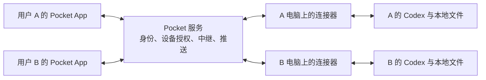

# Pocket 面向多人独立使用：候选架构

2026-10-13。由“用户下载独立 App，连接自己的 Codex，是否要走 Happy 的做法”引出。这里的多人是每个人访问自己的电脑与任务；同一任务邀请他人协作另行设计。本页是研究与架构建议，未实施、未发布，也不是已接受的产品路线。

## 判断

若目标是无需用户配置网络的公网接入，推荐接近 Happy 的三部分形态：**手机 App、电脑连接器、共享的身份与加密中继服务**。它们不要求 Pocket 同时采用 Happy 的执行器生命周期。接受 VPN 或完全自托管时可以减少公共服务，但网络配置与维护会更多地落到使用者身上；本方案按开箱即可配对的体验设计。

按 Pocket 当前“接续桌面原任务”的用途，推荐先把连接与分发通用化，保留原任务控制逻辑；如果目标改为“在自己的电脑上使用 Codex，从 Pocket 发起并管理工作”，则官方 app-server 的托管执行路线更直接。两种路线要分别验证，不能把读取同一 thread ID 的历史当成已经接上同一个运行中的桌面 owner。

## 用户应经历的流程

1. 手机下载 Pocket；电脑安装 Pocket 连接器。首版可以限定 Mac，连接器有托盘窗口和清楚的连接状态。
2. 电脑检测已有 Codex、认证与支持能力，显示配对二维码。手机扫码，双方确认这台电脑并建立设备信任。
3. 手机显示自己的电脑、项目与原任务，可以查看和接续；电脑主动保持到服务端的连接，用户无需配置域名、入站端口、Cloudflare 或 SSH。
4. 断线时保留输入并区分“云端已收”“电脑已收”“Codex 已接受”“执行完成”；回连查询原编号，未知结果不重发。
5. 用户可撤销某部手机、恢复换机身份；电脑退出连接器或休眠后明确显示不可执行。

手机单独安装不能让第三方 App 自动获得电脑上的进程、文件和会话。我们可交付的这条路线需要电脑连接器；其安装和配对也是产品交付的一部分。

电脑主动建立出站长连接；图中的双向箭头表示消息往返。建议 App 与连接器之间对消息和附件端到端加密，中继只处理必要身份/路由元数据与密文。各用户的授权路线分开，不能凭客户端传来的 userId 或 threadId 决定访问权。

## 现有代码怎样拆

| 部分 | 复用 Pocket | 需要改变 |
| --- | --- | --- |
| 手机 App | 列表、阅读、问题/审批、队列和提交反馈逻辑 | 增加配对、设备选择、安全凭据、本地持久草稿、文件导出、推送与回前台恢复。独立 App 不要求立即重写全部 React；仅把当前网址放进 WebView 不会自动获得这些能力 |
| 电脑连接器 | `server/source.mjs`、`history.mjs`、`desktop.mjs`、附件、回执、生命周期逻辑 | 将 Node/Python 和 IPC 依赖整理为可分发安装；移除 `config/desktop-bridge.json` 的个人绝对路径及对整套 FBT 的隐式依赖。可先保留现有语言，按需要再选择原生包装 |
| 身份与设备 Module | 当前认证的部分校验经验 | 从个人服务单口令变为每个用户/设备独立身份、配对、撤销和恢复；模型认证仍由用户电脑上的 Codex 管理。扫码密钥身份可作为首版候选，不必先建设完整邮箱账号平台 |
| 中继 Module | 消息/动作的既有语义和最小公开壳 | 替换当前 Worker 的固定域名、单个 KV `origin` 和单机登记凭据；按已认证用户与获准电脑路由。电脑主动连受控网关，支持断开/代际变化/限流与回执查询；不要求每个用户自建隧道 |
| Codex 接入 Module | 原 owner 控制、保护设置、支持能力检查 | 将 IPC、官方 CLI 管理与版本兼容集中在这一层；对外暴露任务、历史、发送、停止、问题、附件等明确 Interface。单个能力失效只停该能力，不能因已读适配失败阻断历史阅读 |
| 同步与私有存储 | requestId、revision、unknown 不重放、电脑持久队列 | 草稿在手机可靠保存；命令绑定身份、安装实例、thread、requestId 和必要轮次；服务端确认与电脑执行回执分开。需要离线阅读时，再加入有保留期限的密文历史/附件同步 |

先抽出实际变化的 Interface：当前本机 HTTP/PWA 与新 App/中继会共同调用电脑上的任务控制逻辑。不要先为假想的多模型、多租户团队或插件市场铺设通用框架。

### 数据分工

- **电脑权威**：Codex 认证、模型设置、项目文件、执行状态、原任务与最终派发账本。
- **手机权威**：尚未提交的文字/附件草稿、设备密钥、当前阅读位置；需要换设备的草稿同步应显式设计。
- **服务端权威**：用户/设备授权、路由与在线连接代际、推送目的地；可按用途保存密文和最少必要元数据，不接管所有用户的 Codex 计算。
- **端到端加密的工程范围**：使用成熟实现并核验配对身份；换机恢复、设备撤销及后续密钥更新一起设计。服务端不可读正文不等于没有设备/时间/流量元数据，也不免除服务端授权。

这样扩大到更多用户，主要增加的是连接、同步、存储和运营负担；模型运行仍发生在各自电脑及其 Codex 账号所使用的服务。

## Happy 可以借到哪一层

本轮实际读取的 Happy 主分支 HEAD 是 `eb0ecbb5b9d1dba619ffe6bce2207b261f1167b4`。其当前根 README 将产品分为新桌面/Happy Agent 运行时与原 CLI 两条路径；不能用旧资料把今天的 Happy 简化为一个手机遥控器。

原 CLI 的 README 描述扫码、密钥身份、后台 daemon 与手机启动任务。Happy Server 文档描述设备端加密、服务端密文存储/同步与推送。这些是适合借鉴的分工；本轮未运行 Happy、审核完整密码学实现或验证其生产服务。

Codex 源码给出了更重要的区别：`runCodex.ts` 创建 `CodexAppServerClient`，后者在 `codexAppServerClient.ts:608–651` 启动 `codex app-server --listen stdio://` 并持有进程；断开和停止路径可结束或重启这个子进程。因此，复用其原 CLI 不是简单替换 Pocket 的网络管道，它也会带入新的执行器归属、设置与生命周期。

| 路线 | 产品承诺 | 主要代价 |
| --- | --- | --- |
| 保留原桌面接续 | 手机接上用户已经在官方桌面里使用的任务 | 继续承担桌面 IPC、认证身份、版本与同一运行实例的适配；某些能力需共享引擎入口才能补齐 |
| Pocket 托管官方 app-server | 手机/连接器启动、管理并恢复自己的 Codex 工作 | 生命周期可控，便于统一事件与审批；不能默认承诺接管任意正在运行的官方桌面会话，需验证与既有工作并存 |
| 复用 Happy 的整套新运行时 | 采用其新的多模型、桌面与协作产品模型 | 超过本轮“各自连接自己的 Codex”的目标；应先判断是否愿意改变 Pocket 的产品范围 |

可以评估复用 Happy Server 及其协议，也可以只借配对、加密、消息补读机制。它不是一个完全解耦的通用中继 SDK：现有 Happy session/machine 标识、消息封装和密钥生命周期需要与 Pocket 的原 thread、回执、队列语义对应。先用一个真实对象验证适配量，再决定复用多少；本轮不预选整仓 fork。

## 官方接口与竞争基线

OpenAI Docs 当前明确把 **app-server** 定位为自建深度客户端的接口，覆盖认证、历史、审批与流式事件；支持 stdio 和若干 socket 传输。但该文档也明确标注 WebSocket 为 experimental/unsupported，并警告 app-server/远程传输的生产支持边界，不能把文档中存在命令当成可直接公网部署的稳定托管服务。

对于本方案，电脑侧的 Codex 接入与公网中继分开：原桌面路线保持受限 IPC；托管路线优先评估本机 stdio。公网长连接由 Pocket 自己控制认证、路由、恢复与版本兼容，不把一个裸 app-server 端口开放给所有手机。使用 app-server 仍须控制版本并完成实际兼容验收。

官方 Remote 已有同账号、扫码配对、Mac/Windows 主机与手机继续任务的产品路径。本轮读取的文档描述的是官方 App 间连接，没有据此确认可供第三方 Pocket App 直接复用的公共云端中继 Interface。它应作为实际体验对照：Pocket 对外的理由需要落在具体工作流收益上，不能只停留于“手机能连接 Codex”。

## 建议实施顺序与最小验收

1. **先做独立安装。** 在另一台干净 Mac 上装连接器，看到准确原项目和任务、完成一轮原任务回显；没有作者私有目录、FBT 安装或口令依赖。列清实际支持的 Codex 版本和 API-key / ChatGPT 身份，未支持的能力可降级。
2. **再做两人隔离的远程链路。** 两名使用者、两台电脑、各自手机扫码。每人只看自己的设备与任务；另一个人的真实 thread ID 不能被读取或执行；撤销设备后不能继续操作，迟到响应不串到其他电脑。
3. **再完成手机 App 的连续性。** 先复用现有 UI，验证未提交草稿、已上传附件、已受理命令分别在切网/锁屏/强退后如何恢复；丢回执不重复执行。验收推送可见、点击回原任务及生成物原件取回。
4. **最后拓宽系统与分发。** Mac 试用链路成立后再扩 Windows/其他系统；公共发布包括安装升级、诊断、卸载、密钥恢复、兼容回退及服务运营。团队共享任务与代管云端执行不放进首版。

推荐的第一目标：**另一位 Codex 桌面用户无需我们代操作，安装连接器、扫码，在自己的手机继续一条自己的旧任务；同时另一名用户无法访问它。** 这一闭环比先完成一个全新手机界面更能检验多人架构是否成立。

## 来源与核验边界

- Pocket 当前研究 HEAD：`dd6262a5680f7f9a1ae6b51240b2f20a48a8f3bc`。当前代码：[`edge/worker.mjs`](../../edge/worker.mjs)、[`server/auth.mjs`](../../server/auth.mjs)、[`server/source.mjs`](../../server/source.mjs)、[`config/desktop-bridge.json`](../../config/desktop-bridge.json)；契约：[`ARCHITECTURE`](../ARCHITECTURE.md)、[`MOBILE`](../MOBILE.md)、[`CURRENT`](../../CURRENT.md)。09-27 开源评估仅作历史输入，分组/意图等已退休功能不重新作为当前定位。
- [Happy 根 README（固定 SHA）](https://github.com/slopus/happy/blob/eb0ecbb5b9d1dba619ffe6bce2207b261f1167b4/README.md)：新桌面/运行时与原 CLI 的区分。
- [Happy CLI README](https://github.com/slopus/happy/blob/eb0ecbb5b9d1dba619ffe6bce2207b261f1167b4/packages/happy-cli/README.md)：扫码、密钥身份、daemon 与本机 Codex 前置条件。
- [Happy Server README](https://github.com/slopus/happy/blob/eb0ecbb5b9d1dba619ffe6bce2207b261f1167b4/packages/happy-server/README.md)：密文同步、自托管与设备端加密的文档说明；不当作独立安全审计结论。
- [Happy Codex 执行入口](https://github.com/slopus/happy/blob/eb0ecbb5b9d1dba619ffe6bce2207b261f1167b4/packages/happy-cli/src/codex/runCodex.ts#L556)、[子进程创建](https://github.com/slopus/happy/blob/eb0ecbb5b9d1dba619ffe6bce2207b261f1167b4/packages/happy-cli/src/codex/codexAppServerClient.ts#L608)：实际读取，未运行。
- [OpenAI Docs：Codex App Server](https://learn.chatgpt.com/docs/app-server)：本轮搜索后读取全文中的定位、协议与传输限制。
- [OpenAI Docs：Remote connections](https://learn.chatgpt.com/docs/remote-connections)：本轮读取官方配对、设备支持、权限及主机在线条件；没有给当前账号开启或测试官方 Remote。
- [ClawKit/Pocket 当前源码对照](2026-10-13-clawkit-pocket-comparison.md)：原桌面/同引擎路线与验证边界。

所有“需要改变”和实施顺序均为候选设计；本轮仅新增研究文档，不代表多人、端到端加密、独立安装或原生 App 已经完成。
