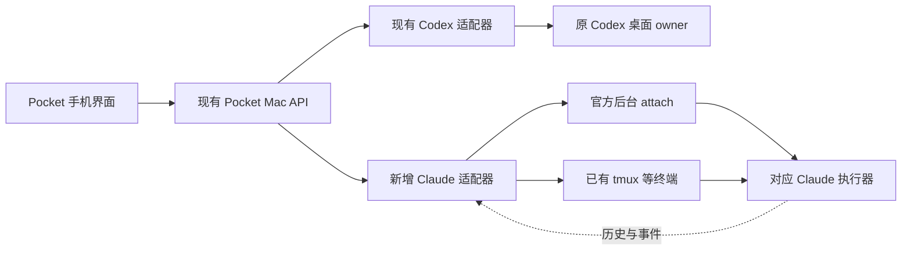

# Pocket 接入 Claude Code：官方接口与开源实现调研

调研日期：2026-10-22（Asia/Shanghai）。本轮目标是判断可行性和选路；未接入产品、安装竞品、改动 Claude 配置或操作真实会话。

## 结论

**Pocket 可以增加 Claude Code 支持，复用现有手机界面和网络链路；需要新增 Claude 适配层。** 若“像连接 Codex 一样”包括继续电脑上正在运行的原执行器，有两条值得优先验证的路线：**官方后台会话的 `claude attach`**，以及 **BotMux Adopt 式原终端桥接**。Happy/HAPI 则提供另一条已有源码的实现思路：保留会话历史，在本地终端与远程执行之间交接。

目前不能承诺：任何普通终端、IDE 或桌面客户端里已经运行的 Claude Code，都能无准备地被 Pocket 热接入；也不能把 `--resume <id>` 当作仍在原进程里执行的证明。

这是依据官方材料和固定版本源码形成的工程判断。开源项目“已有支持”不等于这些能力已在 Pocket、当前机器或手机上验收。

## 1. “同样的连接”需要分清三层

| 层次 | 含义 | 判断 |
| --- | --- | --- |
| 同样的手机体验 | 列表、历史、发消息、看回复、停止、处理提问 | 可行；Pocket 的界面、认证、机器路由、上传与通知等可继续复用，事件和能力语义需适配 |
| 同一段对话 | 恢复相同 session ID 的持久历史 | 官方 CLI/SDK 及 Happy/HAPI 均提供相关路径；不证明进程、在途工具或后台任务保持 |
| 同一个活跃执行器 | 手机与电脑访问原执行器，不另开一个 writer | 官方后台 attach 有文档和本机 CLI 入口；BotMux 受支持终端 Adopt 有对应源码；Pocket 实际控制仍待验证 |

用户的原目标更接近第三层。因此选型不能只看 README 中的“支持 Claude Code”或“same session”。

## 2. Pocket 目前如何连接 Codex

固定代码基线：本地提交 `94b1f21bdbac1a6f10830676cef7b0147c0d578f`（GitHub 尚未包含该提交，以下提供本地文件入口，可用 `git show <SHA>:<path>` 复核原版本）。工作区另有并行任务未提交代码，本报告没有把那些改动作为已交付能力。

- **列表与历史**：`server/source.mjs` 只读 Codex 的 `state_5.sqlite` / `.codex-global-state.json`；`server/history.mjs` 校验原 thread ID 后读取 rollout。历史可读不代表可发送。[P1][P2]
- **执行**：`bin/desktop-bridge.py` 连接现有桌面 IPC，寻找原 owner，再调用 `thread-follower-start-turn`、中断、提问/审批等接口。它声明并实现“不启动另一位 agent”。[P3]
- **服务装配**：`server/index.mjs` 直接装配 `readCodexSource`、`DesktopService` 和 Codex 生命周期服务；`src/types.ts` 的模型仍包含 Codex 专属置顶、型号/强度等字段，尚无完整多 Agent 适配契约。[P4][P5]

可复用的是 **PWA → 现有认证/多机路由 → Mac API**、草稿与队列交互、回执思路和大部分阅读界面。Claude 的会话发现、消息格式、控制通道、权限和生命周期须单独接入，不能直接复用 Codex IPC。

## 3. 开源项目已经做到什么

### 3.1 BotMux：最贴近“原进程接着聊”

[BotMux](https://github.com/deepcoldy/botmux) 把飞书/网页终端连接到本机编程 CLI，通常由 daemon 为会话启动进程；它还有专门的 **Adopt** 模式，用于连接已经运行的终端会话。核实的是 `deepcoldy/botmux`，不是同名 Telegram 项目。

固定版本 `dbefd6bf244fefe4cbefaa984e0587a6f2b60b25`，提交时间 2026-10-22 03:43 +08:00，MIT。

**直接证据：**

1. Adopt 文档明确覆盖 tmux、Zellij、Herdr、Orca 中已运行的 CLI；支持列表与 Claude adapter 源码包含 Claude Code。文档示例就是“tmux 中的 Claude Code 写到一半，从手机接着操作”。[B1][B2]
2. tmux 路径通过 `pipe-pane` 观察输出、`capture-pane` 读取屏幕，通过 `send-keys` / `paste-buffer` 向同一 pane 输入。它不需要重新 `claude --resume` 才能开始桥接。[B3]
3. `resize()` 只有拥有终端生命周期时才改尺寸；`destroySession()` 只有 `ownsSession` 时才结束 tmux。Adopt 断开与原 CLI 退出是不同动作。[B3]
4. Claude adapter 处理 CLI PID、session ID、cwd 与 JSONL 的关联；输入并非简单发送一串文字，还处理多行、按键配置、粘贴节流与 transcript 提交核对。[B2]
5. 另有 AskUserQuestion hook 与 Adopt 路由代码。发现了这些实现不代表任意已运行会话都能立刻得到相同审批卡片；hook 是否已配置、何时生效须实际验证。[B4]

**适合借什么：**原进程归属、终端发现、精确会话绑定、结构化历史投影、停止与断开分离。Pocket 可继续使用自己的手机入口，不需要为了这条技术路线同时采用飞书、机器人配置及其消息注入机制。

**实际边界：**

- 这里的“已有会话”有可连接终端后端这个前提；不等于任意普通 Terminal/VS Code 内的进程都可被接入。
- 文档明确 Adopt 不负责源会话的重建、自动重启或 `/relay`；原 CLI 退出，桥接结束。`/adopt --takeover` 仍被标为未上线。[B1]
- 原进程保留不自动保证所有输入都无竞态；本地草稿、弹窗、会话切换、CLI 快捷键和进程复用仍须校验。
- **不能整段照搬发送成功判定**：Claude adapter 在缺少 JSONL 路径时存在按固定等待返回、可报告 `submitted: true` 的分支；另有跨目录指纹补查。Pocket 应继续要求精确目标与原请求回执，未知不能自动重放，也不能凭同文消息核销另一会话的请求。[B2]

仓库中还读到了 wrapper → 实际 Claude 子进程身份识别的回归样例。该测试使用 fake-claude 验证发现逻辑；本轮未执行它，不将测试文件存在或作者注释当作真实 Claude 端到端通过。[B5]

### 3.2 Happy：官方 SDK 路线与移动端完整参考

[Happy](https://github.com/slopus/happy) 提供手机/浏览器控制、本机 CLI/daemon 与同步服务。此处核实的是仓库内 `packages/happy-cli` 的 Claude 路径，不将仓库内其它新运行时与它混为一谈。

固定版本 `40bad529101f7064c9e9d47013b2f77ff1d6a309`，提交时间 2026-10-21 13:22 UTC，MIT。

- CLI 文档给出 `happy` / `happy claude` 启动、扫码连接，以及手机创建会话。[Y1]
- 源码的本地 launcher 在收到远程消息后请求切换，abort 本地 Claude 并等待退出；远程路径以 `resume` 传递 session ID。[Y2][Y3]
- `sdk/query.ts` 直接包装官方 `@anthropic-ai/claude-agent-sdk` 的 `query()`，映射 cwd、resume、model、权限、MCP、settings 及 `canUseTool`。[Y4]

它证实 **Claude Code 可以接入自定义移动端产品**；此路径主要保持的是对话连续性，而非一直保留原终端进程。它适合参考 SDK 接入、权限回传、历史映射、配对和重连。当前源码还为原生 resume picker 可见性专门处理 entrypoint，说明“同 session ID”之外仍有跨入口兼容工作。[Y4]

### 3.3 HAPI：已有可供其它客户端调用的服务接口

[HAPI](https://github.com/tiann/hapi) 是本地运行、可自托管的远程 Agent 平台，有 Web/PWA、原生客户端、hub 与 runner。

固定版本 `5d8deb201189dc1f183c4f5bf38c87ec4d34dd70`，提交时间 2026-10-20 07:22 +08:00，AGPL-3.0。

- 支持矩阵明确 Claude Code 是 “Terminal wrapper (local) + Claude Agent SDK (remote)”。[H1]
- 实际源码中，远程消息触发本地 launcher abort；循环随后进入 remote launcher，用原 session ID 恢复。其 `sdk/query.ts` 在该快照是自行管理 `claude` 子进程和 stream-json/control protocol 的实现，不能仅凭矩阵名称认定等同 Happy 的官方 npm SDK 包装。[H2][H3]
- 它另有 **本地权限桥**：本地 Claude 运行时通过 hooks 接收手机批准/提问回答，并用原生工具生命周期或 transcript 确认结果。它不把“发出批准”当作“批准已生效”；也明确排除后台子代理等不适用情形。这一点值得 Pocket 借鉴。[H4]
- 已有面向其它客户端的 **REST + SSE 契约**，包含认证、会话、消息分页和重连；终端另走 Socket.IO。因而“Pocket 作为 HAPI 的另一个前端”是有接口依据的候选路线。[H5]

整体使用 HAPI 会引入额外 hub/runner、会话身份与执行交接语义。它可能缩短新建/接续功能的开发，但与 Pocket 当前直连原桌面 owner 的方式不同。若直接复制或修改再提供服务，需按其 AGPL-3.0 处理对应义务；本轮设计研究不受此阻断。

## 4. 官方接口

### 4.1 Remote Control 已经证明官方产品支持本机会话的多端使用

官方说明 Remote Control 连接 `claude.ai/code` / Claude 手机 App 与本机 Claude Code，代码执行和文件访问一直留在本机，可以交替从终端、网页和手机发消息。[O1]

已有交互会话用 `/remote-control` 或 `/rc` 开启；也有 `claude --remote-control` 启动交互会话，以及 `claude remote-control` 服务模式。官方文档还描述了 Desktop Code 和 VS Code 的入口。

本轮文档列出的条件是 Pro/Max/Team/Enterprise 订阅；API key 不支持；Team/Enterprise 要有对应组织权限。自定义 `ANTHROPIC_BASE_URL` 网关、Bedrock/Foundry 等另有不支持边界。未检查当前用户登录、计划或网关配置，故不推断本机账号能否直接开启。

**对 Pocket 的意义**：这证明使用体验可行，但本轮官方文档没有提供供第三方客户端实现 Remote Control 的稳定公开协议。文档描述的是官方 Web/App 经 Anthropic 服务与本机通信，不能把它直接当成 Pocket 可调用的本地 API，也不把“未找到公开协议”写成“内部不存在协议”。

### 4.2 原生后台会话：比只看 SDK 更有价值的新入口

本机只读核验：`claude --version` 为 **2.1.296**；`claude attach --help`、`claude agents --help` 已暴露对应命令。`claude agents --json` 退出码 0，返回 `[]`：确认接口可调用，但当时没有返回可用于 attach 的目标。本轮未新开 Claude 会话。

官方文档给出：[O2]

- `claude --bg`：从启动时运行后台会话。
- `claude agents --json`：受支持的外部状态读取接口；包括 `kind`、后台短 ID、`sessionId`、`pid`、`state`、`status`、`waitingFor` 等字段。比直接解析 `~/.claude/jobs/` 内部文件更合适。
- `claude attach <id>`：连接后台会话的完整交互终端；detach 后会话继续运行，`Ctrl+C` 是当前执行中断，`claude stop` 则是停止会话，两者不能混用。

**候选实现**：Pocket 在 Mac 端为 `claude attach` 提供 PTY，再把输入/输出与结构化历史适配到当前界面。连接的是已经运行的后台执行器，不需要把所有 Claude 会话改为 SDK 执行。官方提供的是 CLI 入口，本轮尚未发现给 Pocket 直接使用的稳定后台双向 JSON 控制 API；PTY 并发连接、输入/审批映射、断开和恢复须做真实验证。

两条容易漏掉的限制：

1. **把现有前台会话 `/bg` 化不是原进程不变**。官方原文是 “Backgrounding starts a fresh process that resumes from the saved conversation”。部分后台工作可迁移；monitor 等不能迁移的工作会受影响。因此不能默默把任意现有会话后台化来宣称已热接入。[O2]
2. **`--resume` 有版本与入口分支**。自 v2.1.285 起，交互终端里 resume 一个仍活跃的后台会话可能转为 attach；但带管道、重定向、`--output-format json` 或改设置的参数时会拒绝。不能用 `claude -p --resume ... --output-format stream-json` 拼成通用热连接接口，也不能绝对地说所有 `--resume` 都只读历史。[O3]

Agent view 仍标为 research preview。当前官方网页还描述了新于本机 2.1.296 的版本特性，实施时应按实际入口探测，不能把整份最新文档当作本机能力清单。

### 4.3 Agent SDK / stream-json：适合由 Pocket 管理的新执行会话

官方 Agent SDK 提供 Claude Code 的 agent loop、工具和上下文管理；CLI `-p` 提供 JSON/stream-json 输出，Python/TypeScript SDK 提供更完整的编程控制。[O4][O5]

- SDK 会话文档提供 resume/fork、`listSessions()`、`getSessionMessages()`，可以用于列表和历史阅读。[O6]
- `canUseTool` 同时处理工具批准与 `AskUserQuestion`，应用展示问题后返回选择；因此 Pocket 的提问/审批界面有结构化适配路线。[O7]
- 这类 SDK 调用通常拥有自己的执行进程。它们与 native background attach、普通原终端桥接是不同的控制方式。

另有明确产品认证约束：官方 SDK overview 写明，未经批准，第三方开发者不能为其产品提供 claude.ai 登录或额度，应使用 API key 认证。[O5] 因此不能因 Happy 的源码存在就承诺 Pocket 将来公开发布时可以直接复用用户的 Claude 订阅。该约束不被扩张为“研究或本地终端桥接都禁止”；个人本地使用与将来对外提供 SDK 产品应分别判断。

## 5. 推荐给 Pocket 的最小落点

**先验证一个 Claude 原会话，不先建设完整多 Agent 平台。** 对从头启动的受控验证，先试官方后台 attach；对已经在 tmux 中运行的现有会话，试 BotMux 式桥接。两者共用 Pocket 的 Claude 适配层，按来源能力选控制方式。

候选改动范围：

| 部分 | 最小变化 |
| --- | --- |
| 会话身份与列表 | 在内部区分 `machineId + provider + nativeSessionId`，保存后台短 ID 或终端/进程绑定；优先 `claude agents --json`，旧 Codex ID 兼容。展示与可控制状态分离 |
| 读取 | 先评估官方 SDK 历史读取，再补必要 Claude 事件投影；排除内部摘要、系统注入与子代理混入，保留真实消息身份 |
| 执行 | 按会话来源选择官方后台 attach 或原终端桥接；现有 Codex owner 路径继续由独立适配器处理 |
| 待发与回执 | 复用 Pocket requestId/unknown 保护，但按 Claude 实际能力实现核对。不能用“已写入终端”冒充“CLI 已接收/模型已完成” |
| 功能显示 | 按能力显示停止、提问、附件和设置；不把 Codex 的置顶、归档、未读或 effort 语义强加给 Claude |
| 以后新建 Claude 会话 | 若后台 attach 路线通过，从启动时使用官方后台会话；若选终端桥接则从启动时持有终端，并显式配置必要 hooks。保留 native session 和本地终端入口 |

建议的最小真实验证（尚未执行）：

1. 专用测试目录与一条受控 Claude 会话，从官方后台启动，记录后台 ID、执行器 PID、session ID、cwd 与启动设置。另用 tmux 已运行会话验证 Adopt 分支；不把用户的现有前台会话直接 `/bg` 化。
2. 只读发现和展示这条会话；同目录再放一个候选，确认不会仅按 cwd 或最新文件选错。
3. 手机发一条简短消息，回读原 transcript 与回复；确认前后执行器 PID/session ID 不变（允许新增 attach 客户端进程），电脑仍能继续输入。
4. 验证运行中停止、一次澄清或权限请求、多行输入；手机发送时电脑留有草稿，应保护草稿并明确拒绝混入。
5. 模拟网络断开后的未知回执，重连只核对、不重复发送；断开 Pocket 后原 Claude 继续存活。再验证 `/clear` 或 `/resume` 后旧请求不能投递到新会话。

通过这组验证，才可说“Pocket 能可靠接续受支持来源中的 Claude 原会话”。若原生 attach/终端桥在当前 Claude 版本上维护成本过高，再评估 Happy 官方 SDK 路径或 HAPI 客户端契约，并明确接受本地/远程执行交接的取舍。

## 6. 证据与验证边界

- 已完成：Pocket 固定提交的相关源码核对；三项目官方 GitHub 仓库的固定快照、README/契约与关键实现交叉阅读；许可证文件检查；官方文档回源；本机 CLI 版本、帮助和空列表接口核验。
- 未完成：三竞品完整安装/运行、Claude 真实发送/审批、手机端体验、长期重连与跨版本稳定性。
- 本轮只修改研究文档及入口，不修改当前服务或用户会话。工作区原有并行改动另行保留。来源 SHA、官方页面采集哈希与只读探测结果见[证据清单](2026-10-22-claude-code-source-manifest.json)。

## 源码索引

### 官方文档

- [O1 Remote Control](https://code.claude.com/docs/en/remote-control)：官方 Web/App、多端接续、认证条件与限制。
- [O2 Agent view](https://code.claude.com/docs/en/agent-view)：后台运行、attach/detach、外部 JSON 状态读取及后台化的进程变化。
- [O3 会话恢复](https://code.claude.com/docs/en/sessions#resume-a-running-background-session)：活跃后台 resume 的 v2.1.285 分支与管道/参数限制。
- [O4 CLI 编程控制](https://code.claude.com/docs/en/headless)：`-p`、JSON/stream-json 与会话恢复。
- [O5 Agent SDK overview](https://code.claude.com/docs/en/agent-sdk/overview)：用途与第三方产品登录/额度限制。
- [O6 SDK 会话](https://code.claude.com/docs/en/agent-sdk/sessions)：resume/fork、`listSessions()`、`getSessionMessages()`。
- [O7 SDK 提问与批准](https://code.claude.com/docs/en/agent-sdk/user-input)：`canUseTool` 与 `AskUserQuestion`。

### Pocket

- [P1 列表来源](../../server/source.mjs)（固定版本 17–25 行）
- [P2 持久历史与身份校验](../../server/history.mjs)（固定版本 156–228 行）
- [P3 原桌面桥接](../../bin/desktop-bridge.py)
- [P4 服务装配](../../server/index.mjs)（固定版本 55–79 行）
- [P5 会话类型](../../src/types.ts)（固定版本 17–49 行）

### BotMux

- [B1 Adopt 文档与边界](https://github.com/deepcoldy/botmux/blob/dbefd6bf244fefe4cbefaa984e0587a6f2b60b25/docs-site/docs/zh/adopt.mdx)
- [B2 Claude 身份/输入适配](https://github.com/deepcoldy/botmux/blob/dbefd6bf244fefe4cbefaa984e0587a6f2b60b25/src/adapters/cli/claude-code.ts#L1297-L1455)；PID 校验另见同文件 664 行起
- [B3 tmux 原 pane 读写与生命周期](https://github.com/deepcoldy/botmux/blob/dbefd6bf244fefe4cbefaa984e0587a6f2b60b25/src/adapters/backend/tmux-pipe-backend.ts#L574-L815)
- [B4 AskUserQuestion hook](https://github.com/deepcoldy/botmux/blob/dbefd6bf244fefe4cbefaa984e0587a6f2b60b25/src/adapters/hook-installer.ts#L346-L404) / [Adopt 路由](https://github.com/deepcoldy/botmux/blob/dbefd6bf244fefe4cbefaa984e0587a6f2b60b25/src/adapters/adopt-route.ts)
- [B5 进程 wrapper 回归样例](https://github.com/deepcoldy/botmux/blob/dbefd6bf244fefe4cbefaa984e0587a6f2b60b25/test/adopt-tmux-claude-wrapper-repro.smoke.test.ts)
- [BotMux MIT](https://github.com/deepcoldy/botmux/blob/dbefd6bf244fefe4cbefaa984e0587a6f2b60b25/LICENSE)

### Happy

- [Y1 CLI 入口](https://github.com/slopus/happy/blob/40bad529101f7064c9e9d47013b2f77ff1d6a309/packages/happy-cli/README.md#L17-L30)
- [Y2 本地进程切换](https://github.com/slopus/happy/blob/40bad529101f7064c9e9d47013b2f77ff1d6a309/packages/happy-cli/src/claude/claudeLocalLauncher.ts#L45-L95)
- [Y3 远程 resume](https://github.com/slopus/happy/blob/40bad529101f7064c9e9d47013b2f77ff1d6a309/packages/happy-cli/src/claude/claudeRemote.ts#L127-L179)
- [Y4 官方 SDK 包装](https://github.com/slopus/happy/blob/40bad529101f7064c9e9d47013b2f77ff1d6a309/packages/happy-cli/src/claude/sdk/query.ts)
- [Happy MIT](https://github.com/slopus/happy/blob/40bad529101f7064c9e9d47013b2f77ff1d6a309/LICENSE)

### HAPI

- [H1 支持矩阵](https://github.com/tiann/hapi/blob/5d8deb201189dc1f183c4f5bf38c87ec4d34dd70/docs/guide/agents.md#L1-L46)
- [H2 本地切换](https://github.com/tiann/hapi/blob/5d8deb201189dc1f183c4f5bf38c87ec4d34dd70/cli/src/modules/common/launcher/BaseLocalLauncher.ts#L70-L105) / [local-remote 循环](https://github.com/tiann/hapi/blob/5d8deb201189dc1f183c4f5bf38c87ec4d34dd70/cli/src/agent/loopBase.ts#L41-L70)
- [H3 stream-json 子进程](https://github.com/tiann/hapi/blob/5d8deb201189dc1f183c4f5bf38c87ec4d34dd70/cli/src/claude/sdk/query.ts#L330-L399) / [resume 选项](https://github.com/tiann/hapi/blob/5d8deb201189dc1f183c4f5bf38c87ec4d34dd70/cli/src/claude/claudeRemote.ts#L158-L182)
- [H4 本地权限桥与真实回读](https://github.com/tiann/hapi/blob/5d8deb201189dc1f183c4f5bf38c87ec4d34dd70/cli/src/claude/utils/localPermissionBridge.ts#L45-L145)
- [H5 其它客户端的 API 契约](https://github.com/tiann/hapi/blob/5d8deb201189dc1f183c4f5bf38c87ec4d34dd70/docs/api/client-contract/index.md)
- [HAPI AGPL-3.0](https://github.com/tiann/hapi/blob/5d8deb201189dc1f183c4f5bf38c87ec4d34dd70/LICENSE)
