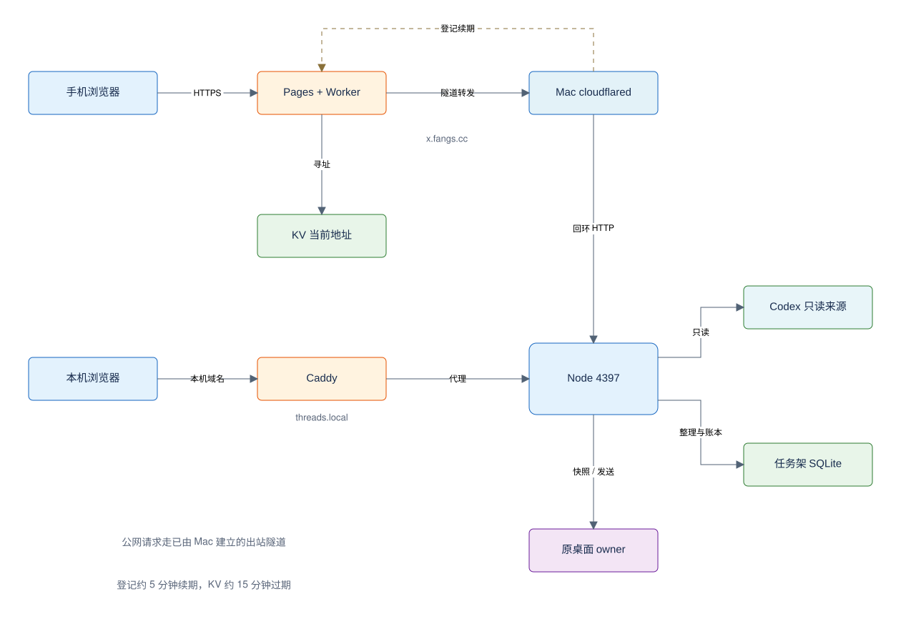

# 把本机 Codex 接到手机：任务架远控的实现原理与边界

事实截止：2026-09-28。本文依据当前实现、自动测试记录和既有线上验收回执，介绍一个个人工具的工程方案。

离开电脑后，我们希望在手机上找到正在做的 Codex 任务、读到最近回复，并在合适的时候把下一条指令交回原任务。任务架（Codex Navigator）为此增加了一个网页入口：浏览器负责展示，Mac 保存状态，原 Codex 桌面进程继续执行任务。

目前，公网登录、任务整理和真实历史读取已经验证；网页发送接口及防重逻辑已实现并通过合成测试，但通过正式网页提交一条新 query、由真实模型完成执行的闭环仍待验收。以下会把实现机制与验证结论分开。

## 1. 总体架构：两个入口，同一台 Mac

任务架使用 React/Vite 前端和 Node HTTP 服务。桌面本地入口是 `https://threads.local`，手机固定入口是 `https://x.fangs.cc`。两者读取同一份任务架数据，并连接同一个 Codex 桌面环境。



图中实线表示请求或数据访问，虚线表示连接登记。HTTP 响应沿请求路径返回；隧道虽然承载从云端进入 Mac 的请求，连接却由 Mac 主动向外建立。

| 入口 | 请求路径 | 适用范围 |
| --- | --- | --- |
| threads.local | 本机浏览器 → 本机回环域名 → Caddy HTTPS 反向代理 → Node 4397 | 该 Mac 的本地访问 |
| x.fangs.cc | 手机浏览器 → Cloudflare Pages 网页 → 同源 Worker API → 当前 Quick Tunnel → Node 4397 | 通过公网连接该 Mac |

`threads.local` 在这台 Mac 上解析到回环地址，不是互联网地址，也不会自动让另一台手机发现电脑。`x.fangs.cc` 的网页壳由 Pages 提供，`/api/*` 则交给 Worker；云端没有另部署一套 Codex，也没有复制一份聊天数据库。

## 2. 隧道解决“怎么连到 Mac”，登记解决“Mac 现在在哪”

Mac 上的 `cloudflared` 主动建立到 Cloudflare 的出站连接，把指定的 `http://127.0.0.1:4397` 服务接入隧道。因此不需要固定公网 IP，也不需要在路由器上做入站端口映射。这是一个 HTTP 服务的暴露范围，不是屏幕共享或整个桌面的开放；该服务自身能执行哪些动作，仍由 API 和原任务权限决定。

当前使用 Quick Tunnel，每次连接器重启都可能得到新的 `https://<随机标识>.trycloudflare.com` 地址。为了让手机始终使用固定入口，系统把寻址拆成两步：

1. Mac 连接器取得隧道地址，调用固定入口的 `POST /api/relay/register`。
2. Worker 校验专用机器凭据，将地址、连接标记和更新时间写入项目专用 KV 的固定记录。
3. 连接器每分钟检查一次；距上次成功登记至少五分钟才续登记，失败后继续按分钟重试。KV 记录十五分钟过期。
4. 业务请求到达 Worker 后读取 KV，找到当前隧道并转发。记录缺失或上游不可达时返回 503，网页壳能打开不等于 Mac 在线。

登记接口只接受严格限定的 HTTPS Quick Tunnel 地址，不允许任意主机、凭据、路径或查询参数。KV 读取有短时缓存和传播延迟，因此地址切换并非瞬时生效，十五分钟也不应理解为全球节点精确同步的下线时刻。

这个设计经历过一次真实故障：隧道和 Node 都正常，但后台依赖的 Wrangler OAuth 过期，续登记失败，最终 KV 过期，固定入口报告 Mac 离线。修复后，运行时登记使用独立的 256-bit 随机机器 key；Mac 保存 key，Worker 配置其 SHA-256 校验值。它只用于登记当前项目的连接地址，不授予任务读取或发送权限。发布代码仍使用 Cloudflare 管理凭据，常驻续登记不再依赖人的 OAuth 登录。

## 3. 列表、历史与 query，是三条不同的数据路径

### 列表与分组：只读来源，加一层自己的整理数据

Codex 的 SQLite 和全局状态 JSON 提供原任务 ID、标题、目录、项目、置顶与归档等信息。适配器以只读模式打开源 SQLite，并启用 `query_only`；任务架不会修改原数据库、全局 JSON 或 rollout 文件。

任务架自己的 SQLite 保存来源元数据快照、分组、接续说明和稍后意图等。用户手动分组不会改变原任务的工作目录、项目绑定或执行权限。来源刷新失败时保留上次快照并显示来源状态，不把失败当成“所有任务都被删除”。

### 可见历史：优先原桌面快照，必要时读取落盘副本

对已加载的原任务，Mac 后端通过 Unix socket 找到当前拥有该任务的桌面客户端（owner），订阅并读取它的 canonical turnHistory。这里的 owner 是运行时任务归属，不是另一个登录账户。

提取范围是用户输入和可见的 assistant 回复：包括普通 `userMessage`、已接受的 `steeringUserMessage`，以及非 analysis 的 `agentMessage`。系统/开发者指令、隐藏推理和工具详情不作为聊天正文展示。

一次线上验收发现“桌面接受了追加输入，网页却没显示”。原因是解析器漏掉了 `steeringUserMessage`。修复后读取其输入、标识与时间；当同一条追加输入已物化为普通用户消息时按 ID 去重。**网页能显示桌面接受的追加消息，不等于网页已支持向运行中任务追加指令。**

桌面快照不可用时，后端尝试只读 rollout：先从源 SQLite 定位文件，校验真实路径位于允许的会话目录，再核对文件首行的任务 ID。仅扫描末尾最多 4 MiB，过滤可见 user/assistant 文本。页面把它标为“已保存的历史”，不从落盘内容推断任务此刻是否空闲。

当前最多展示 80 条可见消息；桌面路径还受最近 30 个 turn 和桌面已加载范围限制。单条最多约 24,000 字符，总量最多约 160,000 字符。页面可见时约每八秒轮询一次，并支持手动刷新。它不是全历史检索，也不是逐 token 实时流。

### 提交 query：让已有桌面 owner 启动下一轮

发送路径是：网页 → 同源私人 API → 本机发送账本 → Python IPC 桥 → 原桌面 owner。网页只能提交文本和请求编号，不能指定或覆盖模型、权限、工作目录。

```http
GET  /api/tasks/<thread-id>/history
POST /api/tasks/<thread-id>/messages
GET  /api/tasks/<thread-id>/messages/<request-id>
```

POST 的请求体只有以下两个字段，其他字段会被拒绝：

```json
{
  "text": "<要交给原任务的文本>",
  "requestId": "<本次提交的 UUID>"
}
```

Python 桥复用已有的长度前缀 Unix socket 客户端。它先进行 owner discovery，读取快照并检查可发送状态，再次回读 owner 与状态后，向同一个 owner 发出 `thread-follower-start-turn`。核心请求语义可简化为：

```javascript
startTurn(owner, {
  threadId,
  clientUserMessageId: requestId,
  input: [{ type: "text", text }],
  context: { inheritThreadSettings: true }
});
```

这是解释语义的伪代码，不是独立 SDK 示例。实际 IPC 包装含协议版本、目标客户端和请求封装。原桌面 owner 继续管理任务状态、模型调用、工具和审批；任务架没有另起 app-server 抢占原任务，也不能靠修改数据库触发模型执行。

## 4. 网络断了，为什么不能直接再发一次

提交动作可能已经到达桌面，但回包在途中丢失。此时直接重发文本可能让模型执行两次。因此发送前先在任务架 SQLite 的 `dispatches` 表记录 requestId、任务 ID、文本哈希和 `pending` 状态；账本不保存 query 原文。

| 状态 | 能确认的事实 | 后续动作 |
| --- | --- | --- |
| pending | 本机已经登记提交意图 | 查询回执与历史 |
| accepted | 原桌面接口已接收，或历史已匹配消息 ID | 刷新历史观察执行进展 |
| rejected | 该次调用明确没有发送 | 保留草稿，处理原因后再提交 |
| unknown | 无法确认有没有发生发送 | 先读回执和原历史，不自动重发 |

相同 requestId 必须对应同一任务和文本哈希，重复 POST 返回已有回执；同一服务进程内，同一任务的并发发送也会被拒绝。前端“核对发送状态”只发 GET，不重新 POST；历史中出现对应 `clientUserMessageId` 时，后端可以把账本修正为 accepted。

这提供的是可回读的防重机制，不是跨所有故障的“恰好一次”保证。桌面接口没有“状态仍等于刚才快照时才执行”的原子条件，最后一次状态检查与提交之间仍有竞态；账本只保存哈希，不负责重启后自动恢复并重发文本。accepted 也只说明接收，不等于模型执行成功或任务完成。

## 5. 安全边界：访问凭据、请求来源、传输与存储分别处理

浏览器登录由 Mac 校验口令，使用 scrypt 保存校验值；登录后签发 Host-only、HttpOnly、SameSite=Strict 的 Cookie，HTTPS 下加 Secure，七天到期。服务端保存会话 token 的 SHA-256，退出或轮换口令可撤销会话，并对失败登录限流。本地入口和公网入口的 Cookie 分别属于各自域名。

写入请求同时检查同源 Origin 和 `X-Navigator-Token` CSRF token；登录/退出仅要求同源。Worker 先核对公网 Origin，再将必要 Cookie、JSON 和 CSRF 头转发给当前隧道；普通代理路径不转发远程 Authorization，并且不跟随上游重定向。Node 继续核对 Host、Origin 和登录状态。本机 CLI 使用另一份 token，只允许无转发头的 loopback 直连路径，不能拿来从公网登录。

开放隧道前，连接器还会匿名访问任务目录，确认返回 401，避免把旧版未保护服务直接暴露出去。口令、浏览器会话、本机 CLI token、机器登记 key 是不同用途的凭据，不能互相替代。当前是个人试用的单用户口令方案；持有口令者可以读取任务，并向符合状态条件的任务提交消息。它不是按任务授权的多人协作系统，短试用口令也不能当成长期公网访问的安全基线。

| 位置 | 本项目持久保存什么 | 本项目不持久保存什么 |
| --- | --- | --- |
| Cloudflare Pages / KV | 公开网页资产；隧道地址、连接标记、更新时间 | 聊天正文、任务目录、口令、浏览器会话 Cookie |
| Mac 原 Codex | 原任务、历史与执行状态 | 仍由 Codex 自己管理，任务架不改写源文件 |
| Mac 任务架 | 整理数据、来源快照、登录会话哈希、发送账本 | 不额外落库聊天正文和 query 原文 |
| 浏览器 | 公开离线页、manifest 和图标等缓存 | 不把目录、说明、聊天写入离线缓存；草稿仅在页面内存 |

历史请求还有最多十个任务、三秒窗口的 Mac 内存复用。响应使用 `Cache-Control: no-store`，Service Worker 不缓存私人 API。上述“不持久保存”描述的是项目实现，不代表浏览器或云服务商所有底层行为都经过审计。

**这不是手机到 Mac 的端到端加密。** 手机到 Cloudflare 使用 HTTPS，Cloudflare 到连接器使用加密隧道，连接器到 Node 是本机回环 HTTP。Cloudflare 终止并转发请求，因此属于信任边界，不能声称第三方完全看不到会话流量。未来若承载有特别保密要求的任务，需要重新选择网络与加密方案，不能仅靠“不写 KV”解决。

Markdown 展示也收紧了边界：CommonMark/GFM 渲染为 React 节点，原始 HTML 不执行；外链限制协议并不携带 referrer，本地文件路径只显示文字；图片显示链接而不自动请求第三方资源。表格和长代码仅在消息内部横向滚动。

## 6. 当前能力与硬限制

| 能力 | 当前行为 |
| --- | --- |
| 查看与整理任务 | 列表、分组、排序、接续说明，沿用原任务 ID |
| 查看历史 | 最近可见 user/assistant 消息、Markdown、约八秒刷新 |
| 连接未加载任务 | 请求 Mac 打开原任务 deep link，再回读状态；不创建新任务 |
| 发送文本 | 原任务已加载、已 resumed、当前可接收下一轮时；最多 16,000 字符 |
| 运行中追加、停止、新建 | 尚不支持 |
| 远程审批、附件上传、工具详情 | 尚不支持，回原桌面处理 |

通常可发送状态是 idle；实现也允许已 resumed 的 systemError 任务继续输入。运行中、待审批/输入、有未确认提交、已归档、子代理任务或不兼容 App 版本均拒绝发送。

IPC 是按版本核验的内部协议，不是官方承诺稳定的公共 SDK。当前适配版本为 `26.903.71938:8576`，涉及 initialize v0、owner discovery v1、following v1、snapshot v11、follower start turn v2。App 升级后版本门禁会关闭该桥接的发送，必须重新核验。

Mac 需要登录、联网、保持唤醒，Codex 与本机服务需正常运行。Quick Tunnel 适合当前验证阶段，不应据此承诺生产 SLA；睡眠唤醒、隔夜运行和不同网络下的长期可靠性尚需观察。

## 7. 已经验证到哪里

以下来自 2026-09-28 的项目验收记录与发布回执。本次写文章回读了源码和证据，没有为了演示向真实任务发送新指令。

| 证据 | 支持的结论 | 不支持的外推 |
| --- | --- | --- |
| 构建与 33 项自动测试通过 | 只读导入、认证、转发、防重、合成 IPC、消息过滤及 Markdown 渲染有回归覆盖 | 真实模型已通过网页完成新 query |
| 正式域名、DNS/TLS 与 10 个公开文件哈希通过 | 对应前端已部署，入口可达且公开资源一致 | 所有业务动作完成验收 |
| 正式登录与真实原任务历史读取成功 | 可读到桌面可见消息，追加消息漏显已修复 | 完整历史、所有类型消息都已覆盖 |
| 390px 浏览器布局与控制台检查通过 | 窄屏无整页横向溢出，表格/代码可内部滚动、输入区可见 | 手机真机键盘、触摸、主屏幕安装已验证 |
| 无有效管理 token 时专用登记成功，重启换址与定时续登记已回读 | 常驻连接恢复不依赖 Wrangler OAuth | 所有休眠、断网和隔夜情况均稳定 |

待完成的关键验收有两项：通过正式网页向合适的空闲原任务提交一次文本，并核对它由原模型执行且只出现一次；用真实手机验证登录、阅读、键盘输入、安装与断网恢复。合成回显不能替代前一项，桌面窄屏模拟不能替代后一项。

## 8. 可复用的工程取舍

这个方案把三件事分开：隧道负责网络可达，任务架负责展示、整理与请求约束，原桌面 owner 负责执行。这样能保留原任务的上下文和权限，也把网络故障、数据读取失败与执行失败分开诊断。

代价同样明确：个人 Mac 成为可用性依赖，Cloudflare 进入内容传输信任边界，内部 IPC 带来版本维护成本。当前最值得复用的是“来源只读、元数据独立、执行归原 owner、未知结果先回读”的约束；是否进一步产品化，应由真实发送、真机体验和持续使用结果决定。

## 实现依据

代码基线：`a69d4c1`；其中当前已发布前端源码为 `a327e5d`。同日状态与验证记录分别在 `CURRENT.md`、`docs/QA.md`，详细契约在 `docs/MOBILE.md`、`docs/CONVERSATION.md` 和 `docs/ARCHITECTURE.md`。以上版本表示本文核对的快照，不代表未来版本。

关键实现定位：网络入口与续登记见 `edge/worker.mjs`、`bin/tunnel.mjs`、`bin/publish-connection.mjs`；来源与历史见 `server/source.mjs`、`server/history.mjs`；发送和认证见 `server/desktop.mjs`、`server/auth.mjs`、`server/index.mjs`；桌面桥见 `bin/desktop-bridge.py` 及其复用的 FBT `app_ipc.py`；前端行为见 `src/Conversation.tsx`、`src/MessageMarkdown.tsx`。这些是代码定位信息，不包含个人机器路径、凭据或真实任务内容。
